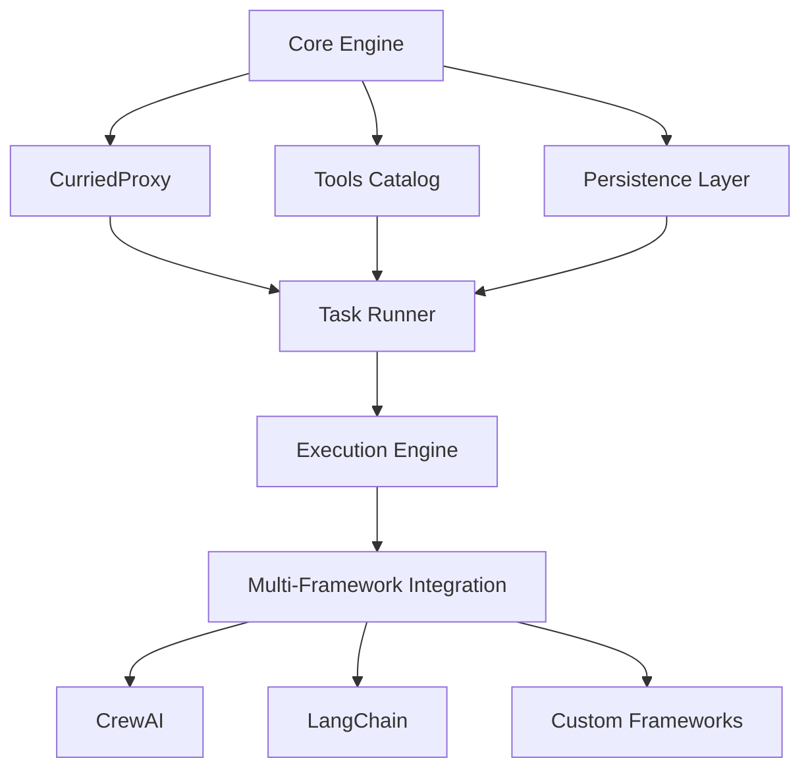
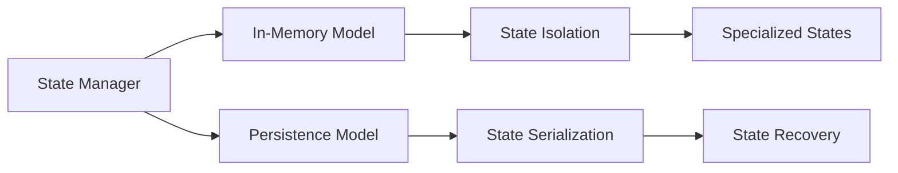
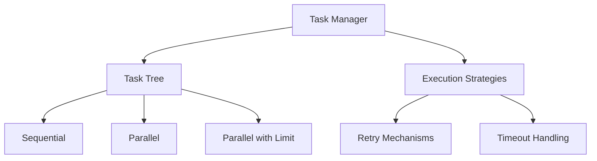
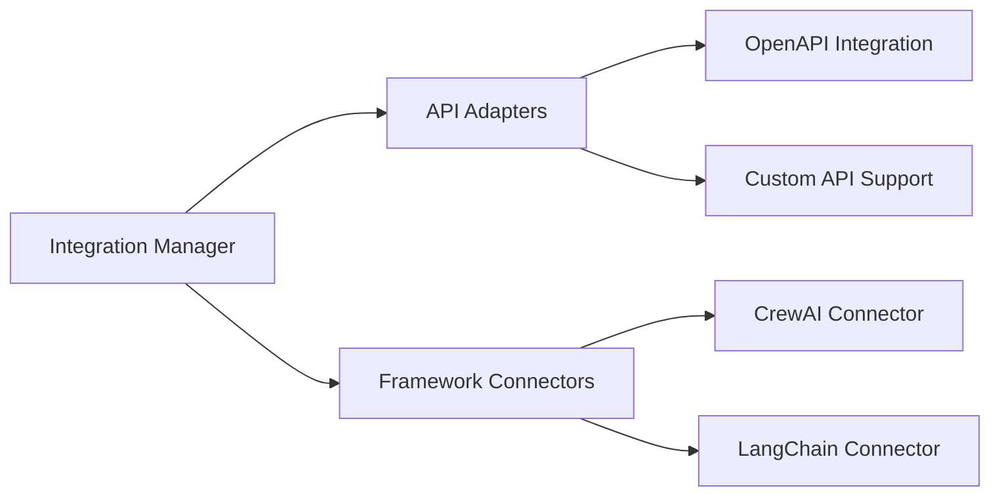
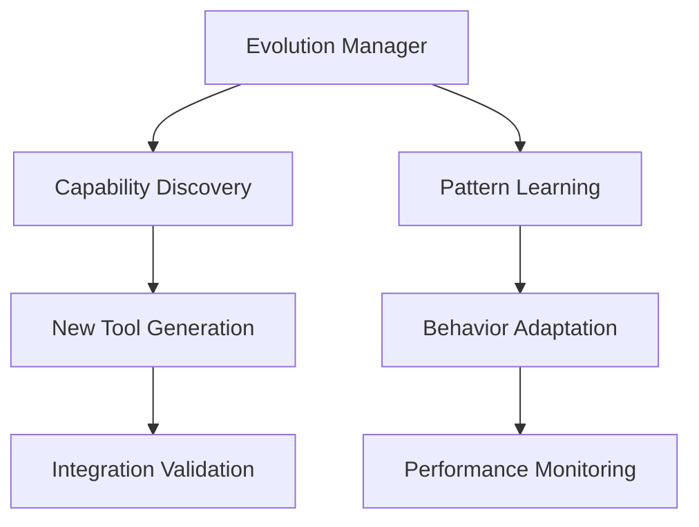
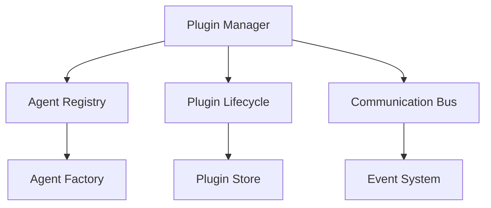
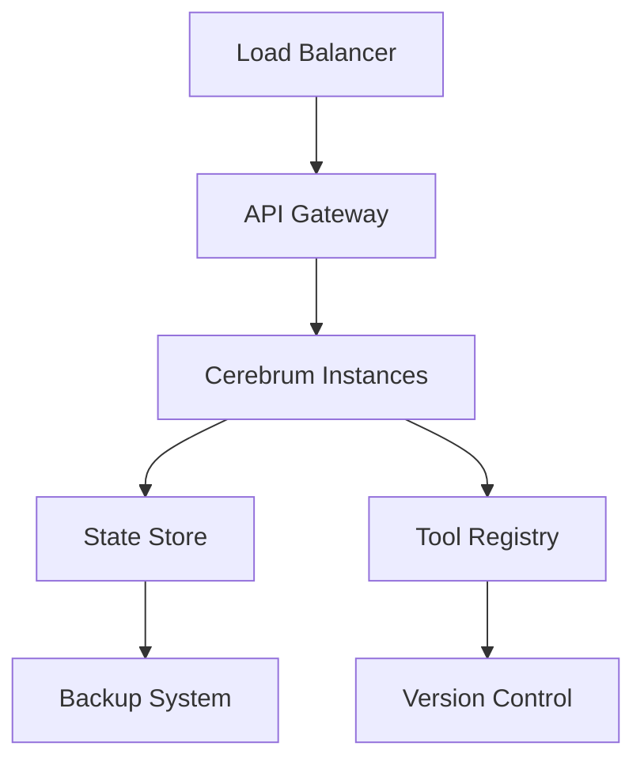

# Cerebrum High-Level Design Document

## Executive Summary
Cerebrum represents a revolutionary approach to AI framework development, offering a self-evolving system that grows and adapts through natural conversation. Unlike traditional frameworks that require explicit programming for every capability, Cerebrum learns and evolves through interaction, making it uniquely suited for enterprise environments where requirements constantly evolve.

This document outlines the architectural design and implementation details of the Cerebrum framework, demonstrating how its components work together to create a robust, adaptable, and secure AI system.

## System Architecture

The architecture of Cerebrum is designed with three primary goals in mind:
1. Enabling natural interaction and self-evolution
2. Maintaining robust security and stability
3. Supporting seamless integration with existing enterprise systems

### 1. Core Components

The core components form the foundation of Cerebrum's architecture, working together to provide a flexible yet stable platform for AI operations.

#### 1.1 Core Engine
The Core Engine serves as the central nervous system of Cerebrum, orchestrating all operations and ensuring smooth communication between components. Its design follows the principle of "smart coordination, loose coupling," allowing individual components to evolve independently while maintaining system cohesion.

**Key Features and Their Purpose**:
- Dynamic tool management: Enables real-time addition and modification of capabilities without system restarts
- State coordination: Ensures consistency across distributed operations
- Task orchestration: Manages complex workflows with dependency handling
- Context management: Maintains operational context for intelligent decision-making

#### 1.2 CurriedProxy
CurriedProxy represents a significant innovation in tool management, acting as an intelligent interface that adapts to different frameworks and execution contexts. This component is crucial for Cerebrum's ability to work with multiple AI frameworks seamlessly.

**Capabilities in Detail**:
- Dynamic tool resolution: Intelligently matches tools to tasks based on context and requirements
- Parameter validation: Ensures type safety and parameter correctness before execution
- Execution orchestration: Manages tool execution across different frameworks
- Type safety enforcement: Prevents runtime errors through strong typing
- Framework-specific adapters: Enables seamless integration with various AI frameworks

#### 1.3 Tools Catalog
The Tools Catalog serves as a dynamic registry of system capabilities, maintaining a comprehensive inventory of available tools and their metadata. This component is essential for Cerebrum's self-evolution capabilities.

**Features and Implementation**:
- Runtime tool registration: Allows dynamic addition of new tools without system downtime
- Metadata management: Maintains detailed information about tool capabilities and requirements
- Version control: Tracks tool versions and manages compatibility
- Dependency tracking: Ensures all required components are available
- Documentation generation: Automatically generates and updates tool documentation

### 2. State Management Architecture

State management in Cerebrum follows a sophisticated approach that ensures data consistency while supporting the system's dynamic nature. The architecture implements a multi-layer state management system that provides both performance and reliability.

#### 2.1 Persistence Layer
The persistence layer implements a robust state management system that ensures data durability while maintaining system performance. This layer is crucial for maintaining system stability during updates and recovering from potential failures.

**Components and Their Roles**:
- PersistenceModelBase: Defines the contract for state management operations
- InMemoryPersistenceModel: Provides high-performance state access
- PersistenceModelFactory: Manages state model instantiation and lifecycle

**Key Features and Benefits**:
- State isolation: Prevents cross-contamination between different operational contexts
- Serialization/Deserialization: Enables efficient state storage and recovery
- Transaction management: Ensures data consistency during complex operations
- Recovery mechanisms: Provides robust failure recovery capabilities

### 3. Task Management System

The Task Management System implements a sophisticated approach to handling complex AI workflows. It supports both simple sequential tasks and complex parallel operations while maintaining system stability and resource efficiency.

#### 3.1 Task Tree Architecture
The Task Tree Architecture provides a flexible and powerful way to organize and execute complex AI workflows. It supports both simple linear processes and complex branching operations while maintaining clear dependency management.

**Key Features and Implementation**:
The hierarchical task organization allows for complex workflow definitions while maintaining clarity and manageability. Each task in the tree can have its own execution strategy, timeout settings, and retry policies, providing fine-grained control over workflow execution.

#### 3.2 Execution Strategies
Execution strategies in Cerebrum are designed to optimize resource utilization while maintaining system stability. The system supports multiple execution patterns to accommodate different workload types and requirements.

**Strategy Implementation Details**:
- Sequential execution: Ensures ordered processing for dependent tasks
- Parallel execution: Maximizes throughput for independent operations
- Resource-limited parallel execution: Prevents system overload while maintaining performance

### 4. Integration Layer

The Integration Layer serves as the bridge between Cerebrum and external systems, providing a flexible and secure way to interact with various AI frameworks and APIs. This layer is crucial for Cerebrum's ability to work with multiple AI technologies seamlessly.

#### 4.1 Framework Integration
Framework integration in Cerebrum is designed to be both flexible and robust, allowing seamless interaction with various AI frameworks while maintaining system stability and performance.

**Integration Architecture**:
The framework integration system uses a plugin architecture that allows new frameworks to be added without modifying the core system. Each framework connector implements a standard interface while handling framework-specific requirements internally.

### 5. Self-Evolution Mechanism

The Self-Evolution Mechanism represents one of Cerebrum's most innovative features, allowing the system to learn from experience and improve its capabilities automatically. This mechanism is carefully designed to ensure safe and controlled evolution while maximizing system capabilities.

#### 5.1 Self-Improvement Features
The self-improvement system implements a careful balance between innovation and stability, allowing Cerebrum to evolve while maintaining reliable operation.

**Implementation Approach**:
The system uses a combination of meta-learning and pattern recognition to identify improvement opportunities. All potential changes undergo rigorous validation before implementation, ensuring system stability.

### 6. Agentic Plugins System

#### 6.1 Plugin Management
The Plugin Management system provides a robust foundation for extending Cerebrum's capabilities through pluggable AI agents and frameworks. This system enables dynamic loading and management of various AI capabilities while maintaining system stability and security.

**Core Components**:
- **Plugin Manager**: Orchestrates plugin lifecycle and resource management
- **Agent Registry**: Maintains catalog of available agents and their capabilities
- **Communication Bus**: Enables inter-agent communication and event propagation
- **Plugin Store**: Manages plugin metadata, versions, and dependencies

#### 6.2 Agent Integration
The Agent Integration layer provides seamless integration of various AI agents and frameworks into the Cerebrum ecosystem. It handles agent lifecycle management, resource allocation, and inter-agent communication.

**Key Features**:
- Dynamic agent loading and unloading
- Resource isolation and management
- State persistence and recovery
- Cross-agent communication
- Security and access control

#### 6.3 Plugin Security
The Plugin Security framework ensures safe operation of plugins within the Cerebrum ecosystem through:
- Code signing and verification
- Sandbox environments for plugin execution
- Resource quotas and limitations
- Access control and audit logging
- Security policy enforcement

## Implementation Guidelines

### 1. Development Standards
Development standards in Cerebrum are designed to ensure code quality, maintainability, and reliability. These standards are enforced through automated tools and code review processes.

**Key Principles**:
Strong typing is enforced throughout the system to prevent runtime errors and improve code clarity. Comprehensive error handling ensures system stability, while extensive logging provides visibility into system operation.

### 2. Security Considerations
Security is a fundamental aspect of Cerebrum's design, implemented at every level of the system. The security architecture follows defense-in-depth principles, ensuring protection against various threat vectors.

**Implementation Details**:
State isolation prevents unauthorized access to sensitive data, while comprehensive audit logging tracks all system operations. Access control is implemented at multiple levels, ensuring fine-grained control over system capabilities.

### 3. Performance Optimization
Performance optimization in Cerebrum follows a systematic approach, focusing on both system-level and operation-level improvements.

**Optimization Strategies**:
The system implements intelligent caching, resource pooling, and lazy loading to maximize performance while maintaining resource efficiency. Batch processing capabilities allow for efficient handling of high-volume operations.

## Deployment Architecture

The deployment architecture of Cerebrum is designed for scalability, reliability, and ease of management. It supports both cloud and on-premises deployments while maintaining consistent operation across environments.

### 1. Scaling Strategy
The scaling strategy implements a multi-dimensional approach, allowing both horizontal and vertical scaling based on workload requirements. This flexibility ensures optimal resource utilization while maintaining system performance.

**Implementation Details**:
Horizontal scaling is achieved through instance replication, with state synchronization ensuring consistency across instances. Load distribution is managed through intelligent routing based on instance capacity and workload characteristics.

### 2. Monitoring and Maintenance
The monitoring and maintenance system provides comprehensive visibility into system operation while enabling proactive maintenance and issue resolution.

**Key Features**:
Performance metrics are collected and analyzed in real-time, enabling quick identification of potential issues. Automated health checks ensure system stability, while automated backup systems protect against data loss.

## Integration Guidelines

### 1. API Integration
API integration in Cerebrum follows REST principles while supporting modern communication patterns like WebSocket and event streaming. This flexibility allows for efficient integration with various client systems.

**Implementation Approach**:
The API layer implements comprehensive error handling and request validation, ensuring reliable operation even under adverse conditions. Support for both synchronous and asynchronous operations allows for efficient handling of different workload types.

### 2. Framework Integration
Framework integration follows a plugin architecture that allows easy addition of new frameworks while maintaining system stability. Each framework integration implements standard interfaces while handling framework-specific requirements internally.

**Key Considerations**:
Configuration templates simplify framework integration, while state synchronization ensures consistent operation across frameworks. Resource sharing is carefully managed to prevent conflicts and ensure optimal resource utilization.

## Conclusion
Cerebrum represents a significant advancement in AI framework development, providing a self-evolving system that combines flexibility with reliability. Its architecture ensures robust operation while enabling continuous improvement and adaptation to changing requirements. The system's design principles of modularity, security, and scalability make it an ideal choice for enterprise AI applications.
