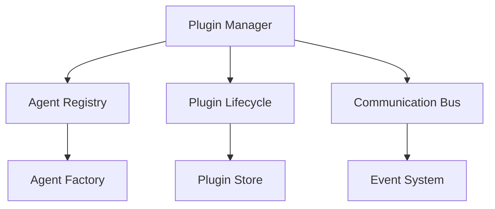

# Cerebrum Architecture Gaps Analysis

## Overview
This document identifies gaps in the current Cerebrum architecture and provides recommendations for a complete implementation. The analysis focuses on critical areas that need enhancement or addition to create a fully functional and robust system.

## 1. Agentic Plugins System

### Current Gap
The architecture lacks a comprehensive plugins system for managing AI agents and their interactions. This is a critical component for enabling dynamic agent behavior and framework extensibility.

### Recommended Implementation

#### Components Needed:
1. **Plugin Manager**
   - Dynamic plugin loading/unloading
   - Version management
   - Dependency resolution
   - Configuration management
   - Resource allocation

2. **Agent Registry**
   - Agent type registration
   - Capability discovery
   - State management
   - Agent lifecycle management
   - Resource tracking

3. **Communication Bus**
   - Inter-agent messaging
   - Event propagation
   - State synchronization
   - Error handling
   - Message routing

4. **Plugin Store**
   - Plugin metadata
   - Version tracking
   - Compatibility checking
   - Update management
   - Security validation

## 2. Enhanced State Management

### Current Gap
The current state management system needs enhancement for handling complex agent states and plugin configurations.

### Recommended Improvements
1. **Agent State Persistence**
   - Individual agent state tracking
   - State versioning
   - State rollback capabilities
   - Cross-agent state synchronization

2. **Plugin State Management**
   - Plugin configuration persistence
   - State isolation between plugins
   - Configuration versioning
   - Hot-reload support

## 3. Security Framework

### Current Gap
The security model needs expansion to handle plugin-specific security concerns and agent access control.

### Recommended Additions
1. **Plugin Security**
   - Code signing
   - Sandbox environments
   - Resource limits
   - Access control policies

2. **Agent Security**
   - Authentication mechanisms
   - Authorization policies
   - Resource quotas
   - Audit logging

## 4. Resource Management

### Current Gap
More sophisticated resource management is needed for handling multiple agents and plugins.

### Recommended Implementation
1. **Resource Allocation**
   - CPU/Memory quotas
   - Network bandwidth management
   - Storage limitations
   - Rate limiting

2. **Resource Monitoring**
   - Usage tracking
   - Threshold alerts
   - Performance metrics
   - Resource optimization

## 5. Framework Integration

### Current Gap
The current framework integration needs enhancement for better plugin support and agent framework compatibility.

### Recommended Improvements
1. **Framework Adapters**
   - Standardized interface
   - Framework-specific optimizations
   - Version compatibility
   - Resource sharing

2. **Plugin API**
   - Stable API contract
   - Versioning support
   - Extension points
   - Event system

## 6. Testing Infrastructure

### Current Gap
Need comprehensive testing infrastructure for plugins and agent interactions.

### Recommended Implementation
1. **Plugin Testing**
   - Unit test framework
   - Integration test suite
   - Performance benchmarks
   - Security scanning

2. **Agent Testing**
   - Behavior verification
   - State management testing
   - Resource usage testing
   - Integration testing

## 7. Documentation System

### Current Gap
Need enhanced documentation for plugin development and agent configuration.

### Recommended Additions
1. **Plugin Documentation**
   - API reference
   - Development guides
   - Best practices
   - Example implementations

2. **Agent Documentation**
   - Configuration guide
   - Interaction patterns
   - State management
   - Troubleshooting

## Implementation Priority

1. **High Priority**
   - Agentic Plugins System core components
   - Enhanced State Management
   - Security Framework basics

2. **Medium Priority**
   - Resource Management
   - Framework Integration improvements
   - Basic Testing Infrastructure

3. **Lower Priority**
   - Advanced Testing capabilities
   - Documentation System
   - Advanced monitoring

## Timeline Estimation

1. **Phase 1 (1-2 months)**
   - Core Plugin System
   - Basic State Management
   - Essential Security

2. **Phase 2 (2-3 months)**
   - Resource Management
   - Framework Integration
   - Basic Testing

3. **Phase 3 (3-4 months)**
   - Advanced Features
   - Documentation
   - Performance Optimization

## Risk Assessment

### Technical Risks
1. Plugin compatibility across versions
2. Resource contention between agents
3. State management complexity
4. Security vulnerabilities

### Mitigation Strategies
1. Comprehensive versioning system
2. Resource isolation mechanisms
3. State validation and recovery
4. Security audit and testing

## Conclusion
Implementing these components will significantly enhance Cerebrum's capabilities, particularly in managing AI agents and plugins. The modular approach allows for incremental implementation while maintaining system stability. 