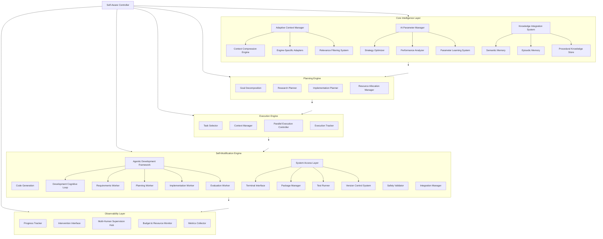
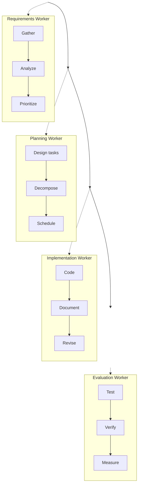
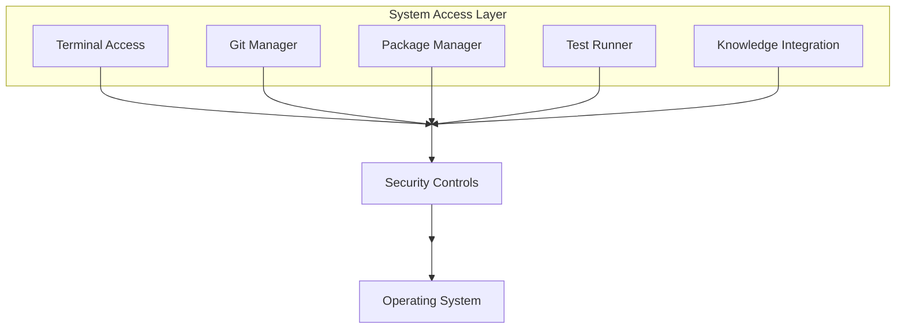
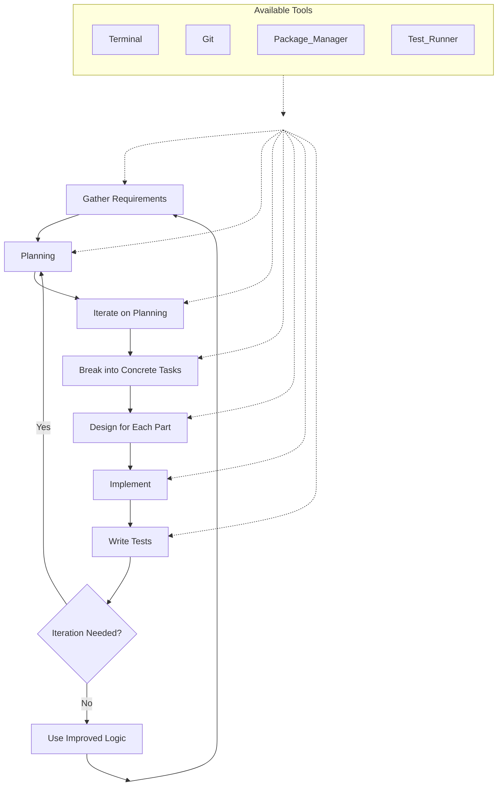
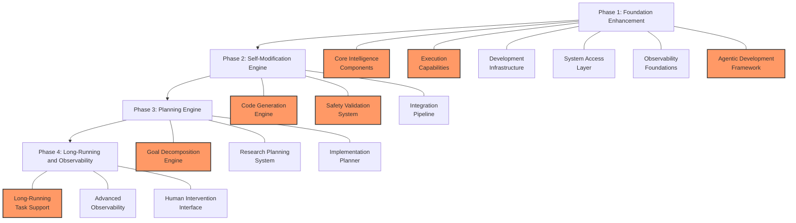

# Self-Aware Cerebrum: High-Level Design

## 1. Overview

The Self-Aware Cerebrum system represents the next evolution of the Cerebrum framework, enabling it to understand, modify, and extend its own capabilities. This high-level design outlines a system that can perform deep technological research, develop complex solutions, and evolve over time without constant human intervention, while still providing observability and allowing for human guidance when needed.

## 2. Current Architecture Analysis

Based on our codebase review, Cerebrum already has several key components that will serve as the foundation for the self-aware system:

### 2.1 Task Execution Models

1. **Task Flow System**: A linear sequence of tasks with transformations between them.
2. **Task Tree Flow System**: A hierarchical organization of tasks with advanced execution strategies.
3. **CrewAI Integration**: Multi-agent execution of tasks with specialized roles.
4. **Agentic Plugins**: Enables seamless integration of third-party agent frameworks and AI systems through a standardized interface.

### 2.2 State Management

1. **Specialized States**: Different states for different purposes (dynamic_tools, scifi_analysis, etc.).
2. **Persistence Model**: Serialization and deserialization of state with proper isolation.
3. **State Loading/Saving**: Utilities for managing state across different specialized domains.

### 2.3 Tool Management

1. **Tools Catalog**: Registry of tools available to the system.
2. **CurriedProxy**: Interface for providing tools to different agents/frameworks.
3. **Dynamic Tool Creation**: Ability to generate new tools at runtime.

## 3. Gaps and Opportunities

While Cerebrum has strong foundations, there are several areas that need enhancement to achieve true self-awareness:

1. **Hierarchical Planning**: Need a system that can break down high-level goals into concrete tasks.
2. **Iterative Task Selection**: Ability to dynamically select which tasks to execute based on context.
3. **Self-Modification Capabilities**: Framework for the system to modify its own code safely.
4. **Continuous Learning**: Integration of research capabilities with development processes.
5. **Long-Running Operations**: Support for tasks that run for days or months.
6. **Man-in-the-Loop Integration**: Ability to observe and intervene without stopping execution.
7. **Web-Based Research Capabilities**: Improve the system's ability to conduct web research, extract relevant information, and integrate findings into its knowledge base.
8. **Resilient Storage and Recovery**: Infrastructure to ensure operational continuity across system restarts and unexpected halts, with robust state persistence and recovery mechanisms.

## 4. Self-Aware System Architecture

The self-aware architecture implements a paradigm shift where AI components take logical leadership of the system's operation, with human oversight serving primarily as guidance and safety mechanisms rather than direct control. The overall architecture embodies a self-directed intelligence with human collaboration.

### 4.1 System Foundation: Hierarchical Task Architecture

At the core of the self-aware system is a hierarchical task architecture that extends the current TaskTreeFlow system with integrated advanced capabilities:

```
Self-Aware Controller
├── Core Intelligence Layer [AI-Led]
│   ├── Adaptive Context Manager
│   │   ├── Context Compression Engine
│   │   ├── Engine-Specific Adapters
│   │   └── Relevance Filtering System
│   ├── AI Parameter Manager
│   │   ├── Strategy Optimizer
│   │   ├── Performance Analyzer
│   │   └── Parameter Learning System
│   └── Knowledge Integration System
│       ├── Semantic Memory
│       ├── Episodic Memory
│       └── Procedural Knowledge Store
├── Planning Engine [AI-Led]
│   ├── Goal Decomposition
│   ├── Research Planner
│   ├── Implementation Planner
│   └── Resource Allocation Manager
├── Execution Engine [AI-Led]
│   ├── Task Selector
│   ├── Context Manager
│   ├── Parallel Execution Controller
│   └── Execution Tracker
├── Self-Modification Engine [AI-Led with Human Safety Gates]
│   ├── Code Generation
│   ├── Safety Validator
│   ├── Integration Manager
│   ├── Agentic Development Framework
│   │   ├── Development Cognitive Loop
│   │   ├── Requirements Worker
│   │   ├── Planning Worker
│   │   ├── Implementation Worker
│   │   └── Evaluation Worker
│   └── System Access Layer
│       ├── Terminal Interface
│       ├── Package Manager
│       ├── Test Runner
│       └── Version Control System
└── Observability Layer [Human-AI Collaborative]
    ├── Progress Tracker
    ├── Intervention Interface
    ├── Multi-Human Supervision Hub
    ├── Budget & Resource Monitor
    └── Metrics Collector
```

The same architecture visualized as a flowchart:



#### AI Leadership and Decision Authority

**Core Intelligence Layer (AI-Led)**
- Central nervous system of the Self-Aware Cerebrum, managing context, parameters, and knowledge
- Adaptive Context Manager maintains coherent understanding across operations while optimizing for different AI engines
- AI Parameter Manager dynamically tunes generative AI parameters based on task requirements and learned patterns
- Knowledge Integration System coordinates different types of memory and knowledge representation
- Completely autonomous in internal management with full decision authority over information processing

**Planning Engine (AI-Led)**
- The AI has full autonomy to analyze goals, break them down, and construct comprehensive plans
- The Planning Engine operates with minimal human input after receiving initial high-level goals
- Strategic decision-making is handled by the AI, which prioritizes research paths and implementation approaches
- Human interaction is primarily consultative, with the AI seeking validation for major directional decisions
- Resource Allocation Manager optimizes distribution of compute, time, and API budgets across planned tasks

**Execution Engine (AI-Led)**
- Task selection and execution sequencing are fully autonomous AI decisions
- The Engine dynamically adapts execution based on real-time analysis of results
- Context management is entirely AI-driven, with the system identifying relevant information and maintaining coherence
- Parallel Execution Controller manages multiple simultaneous workstreams with dynamic prioritization
- Humans can observe execution but the engine operates independently unless intervention is triggered

**Self-Modification Engine (AI-Led with Human Safety Gates)**
- AI leads code generation and improvement proposals
- Safety validation has dual AI/human components:
  - AI performs first-pass validation against safety criteria
  - Critical modifications require human approval before implementation
- Integration is managed by AI but operates within predefined boundaries
- System Access Layer provides secure interfaces to the operating environment, enabling terminal access, package management, testing, and version control with appropriate safety controls
- The system logs all modifications with justifications for human review

**Observability Layer (Human-AI Collaborative)**
- AI proactively generates insights and visualizations for human understanding
- Human operators can configure observation points but the AI suggests critical monitoring areas
- Multi-Human Supervision Hub coordinates input from different supervision roles
- Budget & Resource Monitor provides real-time visibility into resource usage and costs
- The intervention interface provides human guidance capabilities without disrupting AI processes
- Metrics collection and analysis are entirely AI-driven, feeding back into the planning cycle

This enhanced architectural foundation enables the Self-Aware Cerebrum to function as a truly autonomous system with integrated capabilities for context management, parameter optimization, system access, parallel processing, and multi-human supervision—all while maintaining appropriate human oversight for critical operations.

### 4.2 Cognitive Loop

The self-aware system operates through a continuous cognitive loop, with each phase having specific AI leadership characteristics:

1. **Understand (AI-Led, Autonomous)**
   - AI autonomously analyzes the current goal, context, and system state
   - Identifies knowledge gaps through self-assessment without human prompting
   - Determines contextual relevance and prioritizes information independently
   - Decision Authority: Complete autonomy to define the problem space and determine requirements
   - Interaction Model: Informs humans of its understanding but proceeds without requiring approval

2. **Plan (AI-Led, Strategic)**
   - AI develops comprehensive hierarchical plans spanning research, development, and testing
   - Evaluates multiple planning strategies and selects optimal approaches based on predicted outcomes
   - Allocates resources and estimates timelines independently
   - Decision Authority: Full authority over planning strategies with notification to humans on major directional decisions
   - Interaction Model: Presents plans to humans for awareness, adjusts based on feedback but maintains planning autonomy

3. **Execute (AI-Led, Tactical)**
   - AI dynamically selects and executes tasks based on its planning
   - Adapts execution sequence based on emerging results without requiring approval
   - Manages dependencies and parallelism independently
   - Decision Authority: Complete control over execution tactics within the approved strategic plan
   - Interaction Model: Reports progress and significant developments but continues execution independently

4. **Reflect (AI-Led, Analytical)**
   - AI continuously evaluates results against goals without human prompting
   - Identifies successes, failures, and areas for improvement through self-criticism
   - Determines whether to continue, adjust, or abandon approaches
   - Decision Authority: Full authority to analyze outcomes and determine effectiveness
   - Interaction Model: Shares insights with humans but conducts reflection independently

5. **Modify (AI-Proposed, Human-Approved for Critical Changes)**
   - AI proposes system modifications based on reflection
   - Develops implementation plans for enhancements autonomously
   - For critical modifications, creates justifications and safety assessments
   - Decision Authority: Full authority for non-critical changes, requires approval for fundamental or high-risk changes
   - Interaction Model: Autonomous for routine modifications, collaborative for significant architectural changes

The AI initiates and directs transitions between these phases based on its assessment of progress and needs, without requiring explicit human commands to move between phases. The system maintains continuity across the loop, carrying context and insights through each cycle of development.

#### 4.2.1 Cross-Cutting Cognitive Loop Capabilities

Throughout all phases of the cognitive loop, several critical capabilities operate continuously:

**Parallel Processing**: The system can execute multiple parallel streams of work across all phases:
- Multiple research paths can be explored simultaneously during planning
- Parallel task execution with dynamic resource allocation
- Concurrent analysis of different solution approaches
- Prioritization and scheduling based on expected value and resource constraints

**Budget and Resource Awareness**: The cognitive loop maintains continuous awareness of resource usage:
- Real-time cost tracking of computation, API calls, and storage usage
- Dynamic adjustment of strategies to remain within budget constraints
- Predictive modeling of resource requirements for different approaches
- Optimization of resource allocation across parallel processes
- Proactive notification when approaching budget thresholds

**Continuous Supervision Integration**: The system can receive and incorporate guidance without disrupting execution:
- Asynchronous processing of supervision inputs from multiple humans or AI agents
- Seamless incorporation of feedback without halting the cognitive loop
- Role-based reporting tailored to different supervision needs
- Configurable intervention points that don't disrupt overall progress
- Delegation capabilities that allow supervision transitions between humans and AI agents

These capabilities ensure the system can operate efficiently over extended periods, handling complex tasks while remaining responsive to supervision and respectful of resource constraints.

### 4.3 Key Subsystems

#### 4.3.1 Planning Engine

The Planning Engine is responsible for breaking down high-level goals into actionable tasks:

- **Goal Decomposition**: Analyzes user-specified goals and breaks them into subgoals
- **Research Planner**: Plans knowledge acquisition tasks to fill knowledge gaps
- **Implementation Planner**: Creates detailed implementation plans for system enhancements

#### 4.3.2 Execution Engine

The Execution Engine manages the dynamic execution of tasks:

- **Task Selector**: Intelligently selects which tasks to execute based on context and results of previous tasks
- **Context Manager**: Maintains context across task executions, ensuring continuity of understanding
- **Execution Tracker**: Monitors progress of task execution, detecting failures and triggering replanning when necessary

#### 4.3.3 Self-Modification Engine

The Self-Modification Engine enables the system to modify its own code:

- **Code Generation**: Creates code for new capabilities or improvements to existing ones
- **Safety Validator**: Validates that generated code meets safety and integrity requirements
- **Integration Manager**: Safely integrates new code into the running system

#### 4.3.4 Observability Layer

The Observability Layer provides visibility into the system's operations:

- **Progress Tracker**: Shows current progress toward goals
- **Intervention Interface**: Allows human operators to guide or redirect the system
- **Metrics Collector**: Gathers performance metrics to inform future improvements

### 4.4 Human Supervision and Resource Management

The Self-Aware Cerebrum system is designed to operate under human supervision while maintaining execution autonomy and resource awareness. This approach ensures the system remains both powerful and responsible.

#### 4.4.1 Multi-Human Supervision Model

The system supports supervision by multiple humans with different roles and permissions:

```
Supervision Hierarchy
├── Strategic Supervisors
│   ├── Set high-level goals and constraints
│   ├── Approve major architectural changes
│   └── Define resource/budget boundaries
├── Tactical Supervisors
│   ├── Monitor execution progress
│   ├── Provide domain expertise
│   └── Adjust execution parameters
└── Observer/Auditors
    ├── Receive automated reports
    ├── Analyze system behavior
    └── Request explanations of decisions
```

The supervision model allows humans to interact with the system based on their role without disrupting the cognitive loop. Each supervision role can configure the type and frequency of interactions they require.

#### 4.4.2 Budget and Resource Awareness

The system maintains continuous awareness of resource constraints and budgets:

- **Cost Tracking**: Monitors execution costs in real-time (compute, API calls, storage)
- **Budget Enforcement**: Adjusts execution strategies to remain within defined budgets
- **Resource Allocation**: Optimizes distribution of resources across parallel processes
- **Cost Projection**: Forecasts resource needs for planned operations
- **Budget Alerts**: Proactively notifies supervisors when approaching budget thresholds

This capability ensures the system remains economically viable during extended operations, preventing unexpected cost overruns and optimizing resource utilization.

#### 4.4.3 Parallel Process Execution

The Planning Engine incorporates parallel process execution capabilities:

- **Parallel Research Streams**: Investigates multiple approaches simultaneously
- **Work Partitioning**: Decomposes tasks into independently executable components
- **Resource-Aware Scheduling**: Allocates parallel processes based on priority and resource availability
- **Result Integration**: Synthesizes findings from parallel processes into coherent outcomes
- **Execution Coordination**: Manages dependencies between parallel processes

This parallel execution model significantly increases throughput and exploration capacity while respecting overall resource constraints.

#### 4.4.4 Flexible Reporting Mechanisms

The system provides configurable reporting for different supervision roles:

- **Hierarchical Reporting**: Tailors report detail level based on supervisor role
- **Contextual Summaries**: Generates concise overviews with drill-down capabilities
- **Role-Based Dashboards**: Customizes information displays for different stakeholders
- **Session-Specific Updates**: Adjusts reporting frequency based on session requirements
- **Alert Configuration**: Allows supervisors to define critical notification thresholds

These reporting mechanisms ensure that all stakeholders receive appropriate information without overwhelming them with unnecessary details.

#### 4.4.5 Supervision Delegation Models

The system supports the delegation of supervision to specialized AI agents:

- **Agent Delegation**: Supervisors can transfer oversight to specialized AI agents
- **Delegation Boundaries**: Clear definition of delegated authority and constraints
- **Supervision Chain**: Maintains supervision hierarchy through delegations
- **Escalation Paths**: Automated escalation to humans for critical decisions
- **Delegation Records**: Tracks all delegation events and decisions

This capability allows human supervisors to leverage specialized AI agents for routine oversight while maintaining ultimate authority over the system.

All these supervision and resource management capabilities are designed to integrate seamlessly with the cognitive loop without disrupting execution. Inputs from supervisors and resource monitors are incorporated as contextual information that influences the system's behavior without requiring it to stop and restart its processes.

## 5. Technical Design Details

### 5.1 Dynamic Hierarchical Task Selection

Building on the existing TaskTreeFlow system, we'll implement a dynamic node selection process:

```python
class DynamicTaskSelector:
    """Dynamically selects which child tasks to execute based on parent task analysis."""
    
    async def select_tasks(self, parent_node, current_context, previous_results):
        # Analyze results from previously executed children
        analysis = await self._analyze_results(parent_node, previous_results)
        
        # Select next set of child tasks to execute
        selected_tasks = await self._select_next_tasks(parent_node, analysis, current_context)
        
        return selected_tasks
```

### 5.2 Integration with Specialized States

The self-aware system will leverage specialized states for different domains:

1. **Development State**: For system self-improvement and extension
2. **Research State**: For knowledge acquisition and analysis
3. **Execution State**: For applying system capabilities to user-specified domains

Each state will maintain its own persistence model while sharing common tools and context.

### 5.3 Vector Store Integration for Cerebrum Codebase

To enable deep understanding of its own codebase:

```python
class CodebaseContextProvider:
    """Provides context from the codebase for self-modification tasks."""
    
    async def initialize(self):
        # Index the entire codebase in a vector store
        await self._index_codebase()
        
    async def get_relevant_code(self, query):
        # Retrieve relevant code snippets based on a query
        return await self._vector_store.query(query)
```

### 5.4 Long-Running Task Support

To support tasks that run for extended periods:

```python
class LongRunningTaskManager:
    """Manages tasks that run for extended periods with checkpointing."""
    
    async def start_task(self, task, checkpoint_interval=None):
        # Register task for long-running execution
        task_id = await self._register_long_running_task(task)
        
        # Set up checkpointing
        if checkpoint_interval:
            await self._schedule_checkpoints(task_id, checkpoint_interval)
            
        # Start execution in background
        await self._start_background_execution(task_id)
        
        return task_id
```

### 5.5 Man-in-the-Loop Integration

To allow for human guidance without stopping execution:

```python
class HumanInterventionInterface:
    """Provides an interface for human intervention in running tasks."""
    
    async def register_observation_points(self, task_id, observation_points):
        # Register points where the system should notify human observers
        await self._register_observations(task_id, observation_points)
        
    async def register_intervention_points(self, task_id, intervention_points):
        # Register points where the system should pause for human input
        await self._register_interventions(task_id, intervention_points)
```

### 5.6 Resilient Storage and Recovery

To ensure system resilience during long-running operations and recovery after unexpected halts:

```python
class InFilePersistenceModel(PersistenceModelBase):
    """Persistent storage model that serializes state to disk with transaction support.
    
    Extends the base persistence model with file-based storage, atomic transactions,
    and recovery capabilities for long-running operations.
    """
    
    def __init__(self, base_path, backup_path=None):
        super().__init__()
        self._base_path = Path(base_path)
        self._backup_path = Path(backup_path) if backup_path else None
        self._transaction_log = self._base_path / "transaction_log.jsonl"
        self._collections = {}
        self._initialize_storage()
    
    # Implementation details omitted for brevity...

class ResilientStorageManager(InFilePersistenceModel):
    """Extends InFilePersistenceModel with advanced resilience features.
    
    Provides additional capabilities for long-running operations, including
    incremental checkpointing, integrity verification, and adaptive storage
    strategies based on operation criticality.
    """
    
    def __init__(self, base_path, backup_path=None, config=None):
        super().__init__(base_path, backup_path)
        self._config = config or {}
        self._active_operations = {}
        self._checkpoint_schedules = {}
    
    # Implementation details omitted for brevity...
```

The storage and recovery system will integrate with the existing persistence model but extends it with specific capabilities for long-running operations:

#### 5.6.1 Multi-Tier Storage Architecture

The system employs a multi-tier storage architecture to balance performance, durability, and availability:

1. **Memory Cache**: High-speed access for active operation state
2. **Local Persistence**: File-based storage for immediate durability
3. **Distributed Storage**: Replicated storage for high availability (optional)
4. **Cold Storage**: Archival of completed operation data for auditing and learning

#### 5.6.2 Operational Continuity Guarantees

The system provides the following guarantees for long-running operations:

1. **Consistent Checkpointing**: Atomic snapshots of operation state at defined intervals
2. **Progress Preservation**: Operations can resume from the last checkpoint with minimal lost work
3. **State Integrity**: Cryptographic verification of state integrity during recovery
4. **Partial Progress Recovery**: Ability to recover usable partial results even when full recovery fails

#### 5.6.3 Recovery Workflow

When the system restarts after an unexpected halt, it follows a well-defined recovery workflow:

1. **System State Scan**: Identify all in-progress operations at time of halt
2. **Checkpoint Validation**: Verify the integrity of the latest checkpoint for each operation
3. **State Reconstruction**: Rebuild the operational context from the checkpoint data
4. **Execution Strategy Adjustment**: Modify execution plans based on recovered state
5. **Execution Resumption**: Continue operations from the recovered checkpoint

#### 5.6.4 Data Evolution Management

For operations that evolve data structures over time, the system provides:

1. **Schema Versioning**: Tracking of data structure evolution
2. **Migration Pipelines**: Automatic conversion between different versions of data
3. **Compatibility Layers**: Support for operations spanning multiple data schema versions

The storage and recovery system directly extends Cerebrum's existing persistence architecture by inheriting from the PersistenceModelBase class, providing seamless integration with the framework's state management system. This approach offers several advantages:

1. **Architectural Consistency**: By extending the existing persistence model rather than creating a parallel system, we maintain architectural consistency and reduce cognitive overhead.

2. **Code Reuse**: The implementation leverages existing CRUD operations and state management, adding only the resilience features needed for long-running operations.

3. **Transparent Integration**: All components that currently work with the persistence model will automatically benefit from the enhanced resilience without modification.

4. **State Isolation Preservation**: The new implementation maintains the strict state isolation guarantees of the current system while adding transactional safety.

### 5.7 Adaptive Context Management

The Self-Aware system must maintain context across extended operation periods while interfacing with multiple AI engines that have different context capabilities. To achieve this, we'll implement an adaptive context management system:

```python
class AdaptiveContextManager:
    """Manages and optimizes context for various AI engines and operational needs.
    
    Dynamically adjusts context representation, compression, and prioritization
    based on the current task requirements and target AI engine capabilities.
    """
    
    def __init__(self, config=None):
        self._config = config or {}
        self._context_strategies = {}
        self._register_default_strategies()
        self._active_contexts = {}
        self._context_history = {}
        
    def create_context(self, operation_id, initial_content=None, engine_type=None, max_tokens=None):
        """Create a new managed context for an operation."""
        context = {
            "id": operation_id,
            "content": initial_content or [],
            "engine_type": engine_type,
            "max_tokens": max_tokens,
            "token_count": 0,
            "compression_level": 0,
            "summary": None,
            "metadata": {
                "created_at": datetime.now().isoformat(),
                "last_modified": datetime.now().isoformat(),
                "compression_history": []
            }
        }
        
        self._active_contexts[operation_id] = context
        self._update_token_count(operation_id)
        return operation_id
        
    def add_to_context(self, operation_id, content, importance=None):
        """Add new content to a context with optional importance marking."""
        if operation_id not in self._active_contexts:
            raise ValueError(f"Context {operation_id} not found")
            
        context = self._active_contexts[operation_id]
        content_item = {
            "content": content,
            "timestamp": datetime.now().isoformat(),
            "importance": importance or "normal",
            "token_count": self._estimate_tokens(content)
        }
        
        context["content"].append(content_item)
        context["metadata"]["last_modified"] = datetime.now().isoformat()
        
        # Update token count and compress if needed
        self._update_token_count(operation_id)
        if self._should_compress(operation_id):
            self.compress_context(operation_id)
            
        return len(context["content"]) - 1  # Return index of added content
        
    def compress_context(self, operation_id, target_reduction=None):
        """Compress context to reduce token count while preserving important information."""
        if operation_id not in self._active_contexts:
            raise ValueError(f"Context {operation_id} not found")
            
        context = self._active_contexts[operation_id]
        engine_type = context["engine_type"]
        
        # Select appropriate strategy based on engine type
        strategy = self._get_strategy(engine_type)
        
        # Apply compression strategy
        compression_result = strategy.compress(
            context["content"],
            target_reduction=target_reduction,
            importance_weights=self._get_importance_weights()
        )
        
        # Update context with compressed content
        context["content"] = compression_result["content"]
        context["compression_level"] += 1
        context["summary"] = compression_result.get("summary")
        
        # Record compression in history
        context["metadata"]["compression_history"].append({
            "timestamp": datetime.now().isoformat(),
            "level": context["compression_level"],
            "tokens_before": context["token_count"],
            "strategy": strategy.name
        })
        
        # Update token count after compression
        self._update_token_count(operation_id)
        
        return {
            "tokens_removed": compression_result["tokens_removed"],
            "compression_level": context["compression_level"]
        }
        
    def get_context_for_engine(self, operation_id, engine_type=None, max_tokens=None):
        """Get context optimized for a specific engine type and token limit."""
        if operation_id not in self._active_contexts:
            raise ValueError(f"Context {operation_id} not found")
            
        context = self._active_contexts[operation_id]
        target_engine = engine_type or context["engine_type"]
        target_max_tokens = max_tokens or context["max_tokens"]
        
        # If context fits within limits, return as is
        if context["token_count"] <= target_max_tokens:
            return self._format_for_engine(context["content"], target_engine)
            
        # Context needs reduction for this engine
        temp_context = copy.deepcopy(context)
        strategy = self._get_strategy(target_engine)
        
        # Apply just-in-time compression for this request
        compression_result = strategy.compress(
            temp_context["content"],
            target_tokens=target_max_tokens,
            importance_weights=self._get_importance_weights()
        )
        
        return self._format_for_engine(compression_result["content"], target_engine)
```

#### 5.7.1 Multi-Strategy Context Compression

The system employs multiple strategies for intelligently compressing and managing context:

1. **Progressive Summarization**: Older messages are gradually summarized with increasing detail loss based on age and importance
2. **Redundancy Elimination**: Repetitive or duplicative information is consolidated
3. **Time-Series Weighting**: More recent context receives higher preservation priority
4. **Importance-Based Retention**: Context explicitly marked as important is preserved longer and with higher fidelity
5. **Semantic Clustering**: Related information is grouped and potentially compressed together

#### 5.7.2 Engine-Specific Adaptation

The context manager adapts content representation to match different AI engine requirements:

1. **Token Optimization**: Context is formatted and compressed to fit within specific engine token limits
2. **Format Conversion**: Content is transformed to match the expected input format of each engine
3. **Engine-Specific Strategies**: Compression strategies are tailored to the strengths of each engine
4. **Instruction Embedding**: Critical instructions are embedded differently based on engine characteristics
5. **Dynamic Sampling**: Context from different time periods is sampled based on engine capabilities and task needs

#### 5.7.3 Continuation and Resumption Capabilities

To support long-running operations, the context manager provides powerful continuation features:

1. **Checkpoint-Based Resumption**: Operations can resume from specific context checkpoints
2. **Branch Management**: Parallel context branches can be created and later merged
3. **Timeline Navigation**: Operations can "time travel" to resume from specific points without losing subsequent developments
4. **Partial Continuation**: Selected portions of context can be carried forward while others are archived
5. **Context Reconstruction**: Full context can be reconstructed from compressed representations when needed

#### 5.7.4 Context Filtering and Attention Mechanisms

The system employs sophisticated filtering to maintain focus on relevant information:

1. **Relevance Scoring**: Each context element receives a dynamic relevance score to the current operation
2. **Attention Modeling**: The system models what information should receive focus based on the current task
3. **Task-Specific Filtering**: Different filtering strategies are applied based on task requirements
4. **Content Categorization**: Context is categorized (e.g., code, conversation, data) for specialized handling
5. **Semantic Search Integration**: Context can be dynamically expanded through semantic search when gaps are identified

The context management system serves as a crucial bridge between the system's long-term memory (persistence) and its working memory (active operations). By intelligently managing what information is available to each AI engine and in what form, it enables the system to maintain continuity of understanding across extended operations while working within the practical constraints of current AI technologies.

### 5.8 AI Parameter Configuration

The Self-Aware system intelligently configures and adjusts generative AI parameters to optimize task performance across different contexts:

```python
class AIParameterManager:
    """Manages configuration parameters for AI engines.
    
    Provides dynamic parameter adjustment based on task type, historical performance,
    and system-learned optimization strategies.
    """
    
    def __init__(self, default_config=None):
        self._default_config = default_config or self._get_base_defaults()
        self._task_type_configs = {}
        self._engine_type_configs = {}
        self._custom_configs = {}
        self._parameter_history = {}
        self._performance_metrics = {}
        
    def get_parameters(self, task_id, task_type=None, engine_type=None, phase=None, custom_overrides=None):
        """Get optimized parameters for a specific task execution."""
        # Start with base defaults
        params = dict(self._default_config)
        
        # Apply engine-specific defaults if available
        if engine_type and engine_type in self._engine_type_configs:
            params.update(self._engine_type_configs[engine_type])
            
        # Apply task type specific configuration
        if task_type and task_type in self._task_type_configs:
            params.update(self._task_type_configs[task_type])
            
        # Apply phase-specific parameters if available
        if phase and task_type in self._task_type_configs:
            phase_params = self._task_type_configs[task_type].get("phases", {}).get(phase, {})
            params.update(phase_params)
            
        # Apply learned optimizations if available
        learned_params = self._get_learned_parameters(task_type, engine_type)
        params.update(learned_params)
        
        # Apply custom overrides for this specific task
        if task_id in self._custom_configs:
            params.update(self._custom_configs[task_id])
            
        # Apply immediate custom overrides if provided
        if custom_overrides:
            params.update(custom_overrides)
            
        # Validate final parameters
        self._validate_parameters(params, engine_type)
        
        # Record parameters for this task
        self._parameter_history[task_id] = {
            "timestamp": datetime.now().isoformat(),
            "parameters": params,
            "task_type": task_type,
            "engine_type": engine_type,
            "phase": phase
        }
        
        return params
        
    def record_performance(self, task_id, metrics):
        """Record performance metrics for parameter optimization learning."""
        if task_id not in self._parameter_history:
            raise ValueError(f"No parameter history for task {task_id}")
            
        task_params = self._parameter_history[task_id]
        self._performance_metrics[task_id] = {
            "parameters": task_params["parameters"],
            "task_type": task_params["task_type"],
            "engine_type": task_params["engine_type"],
            "phase": task_params["phase"],
            "metrics": metrics,
            "timestamp": datetime.now().isoformat()
        }
        
        # Update learned parameters based on this new data point
        self._update_learned_parameters(
            task_params["task_type"], 
            task_params["engine_type"],
            task_params["parameters"],
            metrics
        )
        
    def _get_base_defaults(self):
        """Get base default parameters for all engines."""
        return {
            "temperature": 0.7,
            "top_p": 0.95,
            "top_k": 40,
            "max_tokens": 2000,
            "presence_penalty": 0.0,
            "frequency_penalty": 0.0,
            "response_format": None,
            "seed": None
        }
    
    def _validate_parameters(self, params, engine_type):
        """Validate parameters are within acceptable ranges for the engine."""
        # Implementation details omitted for brevity
        pass
        
    def _get_learned_parameters(self, task_type, engine_type):
        """Get learned optimal parameters based on historical performance."""
        # Implementation details omitted for brevity
        return {}
        
    def _update_learned_parameters(self, task_type, engine_type, params, metrics):
        """Update learned parameters based on performance metrics."""
        # Implementation details omitted for brevity
        pass
```

#### 5.8.1 Parameter Optimization Strategies

The system employs several strategies for optimizing AI parameters:

1. **Task-Type Based Configuration**: Different task types (e.g., research, coding, planning) have specialized parameter profiles
2. **Phase-Appropriate Settings**: Parameter values vary based on cognitive loop phase (understand, plan, execute, etc.)
3. **Performance-Based Learning**: The system learns optimal parameters through performance metrics evaluation
4. **Hierarchical Parameter Inheritance**: Child tasks inherit and refine parameters from parent tasks
5. **Dynamic Adjustment**: Parameters can be adjusted mid-execution based on interim results

#### 5.8.2 Key Configuration Parameters

The system manages a comprehensive set of AI parameters, including:

1. **Temperature**: Controls randomness in outputs (lower for deterministic tasks, higher for creative tasks)
2. **Top-p (Nucleus Sampling)**: Controls diversity by considering only tokens comprising the top p probability mass
3. **Top-k**: Limits token selection to the top k most likely next tokens
4. **Max Tokens**: Configures maximum response length based on task requirements
5. **Presence/Frequency Penalties**: Adjusts repetition characteristics based on content needs
6. **Response Format**: Specifies required output structure (JSON, markdown, etc.) for specialized tasks
7. **Seed**: Enables deterministic outputs when reproducibility is required

#### 5.8.3 Adaptive Parameter Learning

The system continuously improves parameter selection through:

1. **Performance Correlation Analysis**: Identifies relationships between parameters and task success metrics
2. **A/B Testing**: Systematically varies parameters to detect optimal configurations
3. **Cross-Task Learning**: Applies insights from similar tasks to new contexts
4. **Contextual Adaptation**: Adjusts parameters based on current input complexity and characteristics
5. **Engine-Specific Optimization**: Maintains separate learning models for different AI engines

#### 5.8.4 Parameter Versioning and Experimentation

To support continuous improvement, the system implements:

1. **Parameter Profile Versioning**: Tracks evolution of parameter configurations over time
2. **Experimentation Framework**: Supports structured testing of parameter variations
3. **Performance Metrics Tracking**: Records success metrics for different parameter configurations
4. **Rollback Capability**: Allows reverting to previous parameter profiles when needed
5. **Parameter Explanation**: Provides rationale for parameter selections to human supervisors

This parameter configuration system works in conjunction with the Adaptive Context Management to ensure each AI operation receives both the optimal context and the ideal configuration parameters for its specific requirements, maximizing the system's effectiveness across diverse tasks.

### 5.9 Advanced System Capabilities

To enable true self-evolution, the Self-Aware Cerebrum requires direct access to its operating environment and development tools. These capabilities will be provided through a secure System Access Layer:

```python
class SystemAccessManager:
    """Provides secure, controlled access to system resources and development tools.
    
    Enables the Self-Aware system to interact with its operating environment,
    manage code repositories, run tests, and install dependencies.
    """
    
    def __init__(self, security_config=None):
        self._security_config = security_config or self._get_default_security_config()
        self._active_sessions = {}
        self._credentials_manager = CredentialsManager()
        self._operation_logs = []
        self._pending_approvals = {}
        
    async def execute_terminal_command(self, command, working_directory=None, 
                                      environment_vars=None, timeout=None, 
                                      requires_approval=True, approval_level="standard"):
        """Execute a terminal command with appropriate security controls."""
        # Validate command against security policies
        validation_result = await self._validate_command(command, approval_level)
        
        if validation_result["requires_approval"] and requires_approval:
            # Queue for approval if required
            approval_id = await self._queue_for_approval(
                command, working_directory, environment_vars, 
                approval_level, validation_result["risk_assessment"]
            )
            return {"status": "pending_approval", "approval_id": approval_id}
            
        # Execute command with appropriate isolation
        result = await self._execute_command(
            command, working_directory, environment_vars, timeout
        )
        
        # Log the execution
        await self._log_execution(command, result, approval_level)
        
        return result
        
    async def install_package(self, package_name, version=None, upgrade=False, 
                             environment=None, requires_approval=True):
        """Install a Python package via pip with security validation."""
        # Construct the pip command
        pip_command = f"pip install {package_name}"
        if version:
            pip_command += f"=={version}"
        if upgrade:
            pip_command += " --upgrade"
            
        # Execute with appropriate environment
        return await self.execute_terminal_command(
            pip_command,
            environment_vars={"VIRTUAL_ENV": environment} if environment else None,
            requires_approval=requires_approval,
            approval_level="package_installation"
        )
        
    async def query_system_hardware(self):
        """Query system hardware information safely."""
        # This operation is considered low-risk and doesn't require approval
        commands = {
            "cpu": "lscpu",
            "memory": "free -h",
            "disk": "df -h",
            "gpu": "nvidia-smi" if await self._command_exists("nvidia-smi") else None
        }
        
        results = {}
        for key, cmd in commands.items():
            if cmd:
                results[key] = await self.execute_terminal_command(
                    cmd, requires_approval=False
                )
                
        return results
        
    async def run_unit_tests(self, test_path=None, pattern=None, verbosity=2):
        """Run unit tests on specified modules or the entire project."""
        command = "python -m pytest"
        
        if test_path:
            command += f" {test_path}"
        if pattern:
            command += f" -k '{pattern}'"
            
        command += f" -v" * verbosity
        
        return await self.execute_terminal_command(
            command,
            requires_approval=False,  # Unit tests are considered safe
            approval_level="testing"
        )
        
    async def git_operation(self, operation, repository_path=None, 
                          credentials_id=None, requires_approval=True):
        """Perform Git operations with appropriate credentials and security."""
        if not repository_path:
            repository_path = "."
            
        # Get credentials if provided
        credentials = None
        if credentials_id:
            credentials = await self._credentials_manager.get_credentials(credentials_id)
            
        # Construct the git command
        command = f"git {operation}"
        
        # Determine approval level based on operation
        approval_level = "git_read" if operation.startswith(("status", "log", "diff")) else "git_write"
        
        # Execute with appropriate credentials
        env_vars = {}
        if credentials:
            if "token" in credentials:
                env_vars["GIT_TOKEN"] = credentials["token"]
            if "username" in credentials and "password" in credentials:
                # Use Git credential helper for this process
                # This is a simplified approach - a real implementation would use a more secure method
                env_vars["GIT_USERNAME"] = credentials["username"]
                env_vars["GIT_PASSWORD"] = credentials["password"]
                
        return await self.execute_terminal_command(
            command,
            working_directory=repository_path,
            environment_vars=env_vars,
            requires_approval=requires_approval,
            approval_level=approval_level
        )
        
    async def _validate_command(self, command, approval_level):
        """Validate a command against security policies."""
        # Implementation details omitted for brevity
        return {"requires_approval": True, "risk_assessment": {"level": "medium", "details": {}}}
        
    async def _queue_for_approval(self, command, working_directory, 
                                environment_vars, approval_level, risk_assessment):
        """Queue a command for human approval."""
        # Implementation details omitted for brevity
        return "approval_request_id"
        
    async def _execute_command(self, command, working_directory, environment_vars, timeout):
        """Execute a command in a controlled environment."""
        # Implementation details omitted for brevity
        return {"stdout": "", "stderr": "", "return_code": 0}
        
    async def _log_execution(self, command, result, approval_level):
        """Log command execution for auditing."""
        # Implementation details omitted for brevity
        pass
        
    def _get_default_security_config(self):
        """Get default security configuration."""
        return {
            "approval_levels": {
                "standard": {"requires_approval": True},
                "package_installation": {"requires_approval": True},
                "git_read": {"requires_approval": False},
                "git_write": {"requires_approval": True},
                "testing": {"requires_approval": False},
                "hardware_query": {"requires_approval": False}
            },
            "restricted_commands": [
                # List of potentially dangerous commands that require special handling
                "rm -rf", "sudo", "chmod", "mkfs", "dd", "format", "shutdown",
                "reboot", "systemctl", "service", "init", "passwd"
            ],
            "allowed_packages": {
                "pattern": "^[a-zA-Z0-9_\\-\\.]+$",  # Valid package name pattern
                "blacklist": []  # Explicitly blacklisted packages
            }
        }
```

#### 5.9.1 Secure Terminal Access

The system provides controlled terminal access with several security measures:

1. **Command Validation**: All commands are validated against security policies before execution
2. **Approval Workflow**: Potentially risky commands require human approval before execution
3. **Sandboxed Execution**: Commands run in isolated environments with controlled resource access
4. **Comprehensive Logging**: All command executions are logged for auditing and learning
5. **Risk Assessment**: Automatic analysis of command risk with appropriate control escalation

#### 5.9.2 Package Management

The system can install and manage dependencies with appropriate controls:

1. **Package Validation**: Packages are validated against security policies before installation
2. **Version Control**: Specific package versions can be installed to ensure compatibility
3. **Environment Isolation**: Packages can be installed in isolated environments to prevent conflicts
4. **Dependency Tracking**: The system tracks installed packages and their relationships
5. **Update Management**: Controlled process for updating dependencies with compatibility testing

#### 5.9.3 Version Control Integration

The system can interact with Git repositories for self-management:

1. **Repository Operations**: Clone, commit, push, pull, and branch management capabilities
2. **Secure Credential Management**: Secure handling of repository credentials
3. **Change Tracking**: Integration with system's self-modification workflow
4. **Code Review Integration**: Ability to create and respond to pull requests
5. **Conflict Resolution**: Strategies for resolving merge conflicts autonomously

#### 5.9.4 Testing Framework Integration

The system can run and analyze tests to validate self-modifications:

1. **Test Discovery**: Automatically identify relevant tests for code changes
2. **Test Execution**: Run unit, integration, and system tests in controlled environments
3. **Test Result Analysis**: Analyze test results to identify issues and regressions
4. **Test Coverage Assessment**: Evaluate test coverage and identify gaps
5. **Test Generation**: Create new tests for new or modified functionality

#### 5.9.5 Hardware Awareness

The system can query and adapt to its hardware environment:

1. **Resource Discovery**: Identify available CPU, memory, GPU, and storage resources
2. **Performance Monitoring**: Track resource utilization and performance characteristics
3. **Resource Adaptation**: Adjust execution strategies based on available resources
4. **Hardware-Specific Optimization**: Leverage specialized hardware capabilities when available
5. **Resource Prediction**: Forecast resource needs for planned operations

The Advanced System Capabilities provide the Self-Aware Cerebrum with the tools it needs to truly manage its own evolution, allowing it to operate like a skilled developer with access to all the standard development tools and practices. These capabilities are carefully designed with appropriate security controls to ensure the system operates safely while maximizing its autonomy.

### 5.10 Knowledge Integration System

The Knowledge Integration System provides a comprehensive framework for organizing, storing, and retrieving different types of knowledge, enabling the Self-Aware Cerebrum to maintain a coherent understanding of its domain across long-running operations:

```python
class KnowledgeIntegrationSystem:
    """Central system for managing and integrating different knowledge types.
    
    Coordinates between semantic, episodic, and procedural knowledge repositories,
    providing a unified interface for knowledge storage and retrieval.
    """
    
    def __init__(self, config=None):
        self._config = config or {}
        self._semantic_memory = SemanticMemory(config.get("semantic_config"))
        self._episodic_memory = EpisodicMemory(config.get("episodic_config"))
        self._procedural_store = ProceduralKnowledgeStore(config.get("procedural_config"))
        self._knowledge_graph = KnowledgeGraph()
        
    async def store_knowledge(self, knowledge_item, knowledge_type=None, metadata=None):
        """Store a knowledge item with appropriate type classification."""
        # Automatically classify knowledge type if not specified
        if not knowledge_type:
            knowledge_type = await self._classify_knowledge_type(knowledge_item)
            
        metadata = metadata or {}
        metadata["stored_at"] = datetime.now().isoformat()
        
        # Store in appropriate memory system
        if knowledge_type == "semantic":
            knowledge_id = await self._semantic_memory.store(knowledge_item, metadata)
        elif knowledge_type == "episodic":
            knowledge_id = await self._episodic_memory.store(knowledge_item, metadata)
        elif knowledge_type == "procedural":
            knowledge_id = await self._procedural_store.store(knowledge_item, metadata)
        else:
            raise ValueError(f"Unknown knowledge type: {knowledge_type}")
            
        # Update knowledge graph with new connections
        await self._knowledge_graph.integrate_item(knowledge_id, knowledge_type, knowledge_item, metadata)
        
        return knowledge_id
        
    async def retrieve_knowledge(self, query, knowledge_types=None, limit=10):
        """Retrieve knowledge matching the query across specified knowledge types."""
        knowledge_types = knowledge_types or ["semantic", "episodic", "procedural"]
        
        # Query the knowledge graph for relevant knowledge IDs
        relevant_ids = await self._knowledge_graph.query(query, knowledge_types)
        
        results = []
        for knowledge_type, ids in relevant_ids.items():
            if knowledge_type == "semantic":
                items = await self._semantic_memory.retrieve_many(ids)
            elif knowledge_type == "episodic":
                items = await self._episodic_memory.retrieve_many(ids)
            elif knowledge_type == "procedural":
                items = await self._procedural_store.retrieve_many(ids)
                
            results.extend(items)
            
        # Sort by relevance and limit results
        results = sorted(results, key=lambda x: x["relevance"], reverse=True)[:limit]
        
        return results
        
    async def connect_knowledge(self, source_id, target_id, relationship_type, metadata=None):
        """Create an explicit connection between knowledge items."""
        await self._knowledge_graph.add_edge(source_id, target_id, relationship_type, metadata)
        
    async def get_knowledge_context(self, knowledge_id, depth=2):
        """Retrieve the context surrounding a knowledge item."""
        # Get the knowledge item and its neighbors in the graph
        context = await self._knowledge_graph.get_subgraph(knowledge_id, depth)
        
        # Retrieve the actual knowledge items
        knowledge_context = {}
        for k_type, ids in context["nodes"].items():
            if k_type == "semantic":
                knowledge_context[k_type] = await self._semantic_memory.retrieve_many(ids)
            elif k_type == "episodic":
                knowledge_context[k_type] = await self._episodic_memory.retrieve_many(ids)
            elif k_type == "procedural":
                knowledge_context[k_type] = await self._procedural_store.retrieve_many(ids)
                
        knowledge_context["relationships"] = context["edges"]
        
        return knowledge_context
```

#### 5.10.1 Memory Types

The Knowledge Integration System manages three primary types of memory:

1. **Semantic Memory**: Stores factual and conceptual knowledge
   - Domain-specific facts and relationships
   - Conceptual frameworks and definitions
   - System architecture and capabilities understanding
   - External knowledge from research and documentation

2. **Episodic Memory**: Records experiences and historical events
   - Task execution history with contextual details
   - Problem-solving episodes with outcomes and insights
   - User interactions and feedback history
   - System modification events and their impacts

3. **Procedural Knowledge Store**: Maintains action-oriented knowledge
   - Code patterns and implementation techniques
   - Task execution strategies and workflows
   - Tool usage patterns and best practices
   - Debugging and problem-solving procedures

#### 5.10.2 Knowledge Graph Integration

The system maintains a unified knowledge graph that connects items across different memory types:

1. **Cross-Type Relationships**: Links between semantic, episodic, and procedural knowledge
2. **Temporal Relationships**: Connections based on time sequence and causality
3. **Semantic Relationships**: Associations based on meaning and relevance
4. **Dependency Relationships**: Connections between knowledge items that build upon each other
5. **Priority Relationships**: Links that indicate importance or urgency hierarchies

#### 5.10.3 Knowledge Retrieval Strategies

The system employs sophisticated strategies to retrieve relevant knowledge:

1. **Multi-Vector Search**: Simultaneous search across embeddings, keywords, and metadata
2. **Context-Aware Retrieval**: Prioritization based on current task context and goals
3. **Temporal Relevance**: Consideration of recency and historical importance
4. **Associative Activation**: Following relationship paths through the knowledge graph
5. **Predictive Retrieval**: Anticipating knowledge needs based on task patterns

#### 5.10.4 Knowledge Evolution Management

To maintain relevance and accuracy over time, the system provides:

1. **Knowledge Validation**: Verification of knowledge against new information
2. **Contradiction Resolution**: Reconciliation of conflicting knowledge items
3. **Confidence Scoring**: Assessment of knowledge reliability and certainty
4. **Obsolescence Detection**: Identification of outdated knowledge
5. **Knowledge Synthesis**: Creation of new knowledge by combining existing items

#### 5.10.5 Integration with Cognitive Loop

The Knowledge Integration System plays a critical role in each phase of the cognitive loop:

1. **Understand Phase**: Provides relevant domain knowledge and historical context
2. **Plan Phase**: Supplies procedural knowledge and past planning strategies
3. **Execute Phase**: Delivers implementation patterns and previous solution approaches
4. **Reflect Phase**: Offers comparative cases for evaluation and learning
5. **Modify Phase**: Supports reuse of proven modification patterns and techniques

This comprehensive knowledge management approach enables the Self-Aware Cerebrum to leverage past experiences, maintain conceptual understanding across extended operations, and continuously evolve its knowledge base through learning and integration of new information.

### 5.11 Agentic Development Framework

The Self-Aware Cerebrum requires a systematic approach to its own development, creating a framework that enables it to evolve through iterative improvements of its own codebase. The Agentic Development Framework provides the methodology and architecture for this self-directed evolution.

#### 5.11.1 Core Architecture Principles

The Agentic Development Framework is guided by three key principles:

1. **Simplicity in design**: Even sophisticated agent behaviors can be implemented through straightforward patterns
2. **Transparency**: The system should explicitly show planning steps and reasoning
3. **Well-crafted tools**: Tools should be thoroughly documented, tested, and designed with the LLM in mind

#### 5.11.2 Iterative Development Loop Architecture

The Development Cognitive Loop implements an Autonomous Agent pattern with Orchestrator-Workers structure as the core mechanism for iterative self-improvement:

```mermaid
flowchart TD
    DCL[Development Cognitive Loop] --> CIO
    
    subgraph CIO[Core Intelligence Orchestrator]
        direction TB
        U[Understand] --> P[Plan]
        P --> E[Execute]
        E --> R[Reflect]
    end
    
    %% Add spacing between orchestrator and workers
    CIO --> VSpace1[" "]:::empty
    
    %% Connect to workers with spacing
    VSpace1 --> RW & PW & IW & EW
    
    U --> RW[Requirements Worker]
    P --> PW[Planning Worker]
    E --> IW[Implementation Worker]
    R --> EW[Evaluation Worker]
    
    %% Add spacing between workers and system access layer
    RW & PW & IW & EW --> VSpace2[" "]:::empty
    VSpace2 --> SAL
    
    subgraph SAL[System Access Layer]
        direction TB
        TA[Terminal Access]
        GM[Git Manager]
        PM[Package Manager]
        TR[Test Runner]
        KI[Knowledge Integration]
    end
    
    %% Group all components to connect to Security Controls
    TA & GM & PM & TR & KI --> SpacerNode[" "]:::empty
    SpacerNode --> SC[Security Controls]
    
    %% Add vertical separation between Security Controls and OS
    SC --> OSSpacer[" "]:::empty
    OSSpacer --> OS[Operating System]
    
    classDef empty width:0px,height:0px,fill:none,stroke:none;
```

#### 5.11.3 Development Cognitive Loop Components

The Development Cognitive Loop consists of a Core Intelligence Orchestrator that directs the overall development process, specialized workers that focus on specific aspects of development, and a System Access Layer that provides secure access to development tools.

##### Core Intelligence Orchestrator

The Core Intelligence Orchestrator operates through the four phases of the cognitive loop:

1. **Understand Phase (AI-Led)**
   - Analyzes requirements, context, and system state
   - Identifies knowledge gaps through self-assessment
   - Delegates detailed analysis to Requirements Worker when needed
   - **Outputs**: Comprehensive understanding of objectives and constraints

2. **Plan Phase (AI-Led)**
   - Develops comprehensive hierarchical implementation plans
   - Evaluates multiple approaches based on predicted outcomes
   - Delegates detailed planning to Planning Worker
   - **Outputs**: Task breakdown, dependency structure, and implementation roadmap

3. **Execute Phase (AI-Led)**
   - Dynamically selects and prioritizes implementation tasks
   - Manages parallel implementations through Implementation Worker
   - Adapts execution based on emerging results
   - **Outputs**: Code, documentation, and system changes

4. **Reflect Phase (AI-Led)**
   - Evaluates results against goals through Evaluation Worker
   - Identifies successes, failures, and areas for improvement
   - Determines whether to continue, adjust, or abandon approaches
   - **Outputs**: Evaluation report and improvement recommendations

##### Specialized Workers

Each worker is an augmented LLM with specific expertise, tooling, and prompt optimization:



1. **Requirements Worker**
   - Gathers requirements from stakeholders and documentation
   - Analyzes existing codebase to understand constraints
   - Prioritizes requirements based on dependencies and value
   - **Tools Used**: Code search, file reading, documentation analysis

2. **Planning Worker**
   - Breaks down requirements into actionable tasks
   - Designs implementation approaches for each component
   - Creates test strategies to verify implementation
   - **Tools Used**: Codebase search, architecture diagramming, task scheduling

3. **Implementation Worker**
   - Writes code according to the planning specifications
   - Documents implementation details and decisions
   - Makes architectural modifications when needed
   - **Tools Used**: Terminal, git operations, code editing, package management

4. **Evaluation Worker**
   - Runs tests to verify implementation
   - Analyzes metrics and results
   - Identifies areas for improvement
   - **Tools Used**: Test runner, performance measurement, code quality analysis

##### System Access Layer

The System Access Layer extends the capabilities described in section 5.9 (Advanced System Capabilities) to provide comprehensive access to development tools:



1. **Terminal Access**
   - Executes terminal commands with appropriate security controls
   - Validates commands against security policies
   - Provides command history and context

2. **Git Manager**
   - Performs repository operations (clone, commit, push, pull)
   - Handles branch management and merging
   - Manages credentials securely

3. **Package Manager**
   - Installs and manages dependencies
   - Validates packages against security policies
   - Tracks dependency relationships

4. **Test Runner**
   - Discovers and executes tests
   - Analyzes test results
   - Generates test coverage reports

5. **Knowledge Integration**
   - Maintains semantic, episodic, and procedural knowledge
   - Provides knowledge retrieval across different types
   - Supports contextual understanding of development history

#### 5.11.4 Cross-Cutting Capabilities

These capabilities operate across all phases of the development loop:

1. **Parallel Processing**
   - Multiple tasks can be executed simultaneously
   - Work is prioritized based on dependencies and impact
   - Results are integrated into a coherent whole

2. **Human Supervision**
   - Strategic supervisors approve major architectural decisions
   - Tactical supervisors provide domain expertise
   - Human feedback is integrated at configurable checkpoints

3. **Adaptive Context Management**
   - Maintains coherent understanding across extended operations
   - Optimizes context representation for different AI engines
   - Provides continuation capabilities for long-running tasks

#### 5.11.5 Complete Development Workflow

The complete development workflow represents the system's ability to improve itself through iterative development:



The workflow enables the system to:
- Gather requirements from various sources
- Create and refine development plans
- Break complex tasks into manageable units
- Design architectural components
- Implement code changes
- Verify through testing
- Iterate when necessary
- Apply learned improvements to future development cycles

This iterative process operates as a continuous loop, with each cycle improving the system's capabilities while maintaining access to the full spectrum of development tools at every stage.

## 6. Implementation Strategy

The implementation of the Self-Aware Cerebrum will proceed through a phased approach, with each phase delivering testable capabilities that build toward the complete system. This strategy prioritizes foundational components first, ensuring a solid base for more advanced capabilities while providing incremental value at each stage.

### 6.1 Implementation Roadmap Overview

The implementation is organized into four major phases, each with specific components that can be developed and tested independently while maintaining clear integration points:



Each component follows a consistent development cycle:

1. **Component Planning**
   - Define specific requirements and interfaces
   - Create detailed design documents
   - Establish test criteria and performance metrics
   - Identify dependencies and risks

2. **Incremental Development**
   - Implement core functionality first
   - Add features incrementally
   - Regular integration with dependent components
   - Continuous unit testing

3. **Validation Cycle**
   - Unit testing of all features
   - Integration testing with dependent components
   - Performance and scalability testing
   - Security and safety validation

4. **Documentation and Finalization**
   - Complete API documentation
   - Create usage examples
   - Document known limitations
   - Establish maintenance procedures

### 6.2 Phase 1: Foundation Enhancement

#### 6.2.1 Core Intelligence Components

**Component 1A: Adaptive Context Manager**
- **Deliverables**:
  - Context compression engine with multiple strategies
  - Engine-specific adapters for different AI models
  - Relevance filtering system
- **Implementation Cycle**:
  - Week 1-2: Design and implement base context management system
  - Week 3: Implement compression strategies
  - Week 4: Create engine-specific adapters
  - Week 5: Develop and test relevance filtering
  - Week 6: Integration testing and documentation
- **Testing Strategy**:
  - Unit tests for each compression algorithm
  - Performance testing for context handling efficiency
  - Integration tests with multiple AI engines
  - Snapshot tests for context consistency
- **Dependencies**: None (foundational component)
- **Success Criteria**:
  - Successfully maintains context across 10+ interactions
  - Achieves 40%+ compression with minimal information loss
  - Adapts to at least 3 different AI engine formats

**Component 1B: AI Parameter Manager**
- **Deliverables**:
  - Strategy optimizer for parameter selection
  - Performance analyzer for historical results
  - Parameter learning system
- **Implementation Cycle**:
  - Week 1: Design parameter management system
  - Week 2-3: Implement strategy optimizer
  - Week 4: Develop performance analyzer
  - Week 5: Create parameter learning system
  - Week 6: Integration testing and documentation
- **Testing Strategy**:
  - Unit tests for optimization algorithms
  - A/B tests for parameter effectiveness
  - Integration tests with AI engines
  - Regression tests for learning capabilities
- **Dependencies**: None (foundational component)
- **Success Criteria**:
  - Demonstrates measurable performance improvements over baseline configurations
  - Successfully learns optimal parameters for at least 5 common task types
  - Provides explainable parameter selection rationales

**Component 1C: Knowledge Integration System**
- **Deliverables**:
  - Semantic memory implementation
  - Episodic memory implementation
  - Procedural knowledge store
  - Knowledge graph for cross-type relationships
- **Implementation Cycle**:
  - Week 1: Design knowledge system architecture
  - Week 2: Implement semantic memory
  - Week 3: Implement episodic memory
  - Week 4: Develop procedural knowledge store
  - Week 5: Create knowledge graph integration
  - Week 6-7: Integration testing and documentation
- **Testing Strategy**:
  - Unit tests for each memory type
  - Retrieval efficiency testing
  - Knowledge graph traversal tests
  - Cross-memory integration tests
- **Dependencies**: None (foundational component)
- **Success Criteria**:
  - Successfully stores and retrieves all knowledge types
  - Demonstrates effective knowledge relationships in graph
  - Provides relevant knowledge for specific queries across types

#### 6.2.2 Execution Capabilities

**Component 2A: Dynamic Task Selection**
- **Deliverables**:
  - Dynamic task selector for TaskTreeFlow
  - Context-based selection algorithms
  - Result analysis system
- **Implementation Cycle**:
  - Week 1: Design dynamic selection system
  - Week 2-3: Extend TaskTreeFlow with selection capabilities
  - Week 4: Implement selection algorithms
  - Week 5: Create result analysis subsystem
  - Week 6: Integration testing and documentation
- **Testing Strategy**:
  - Unit tests for selection algorithms
  - Task tree navigation tests
  - Selection accuracy tests with various contexts
  - Performance testing for large task trees
- **Dependencies**: TaskTreeFlow implementation
- **Success Criteria**:
  - Successfully selects appropriate tasks based on context
  - Adapts selection based on previous results
  - Handles task trees with 50+ nodes efficiently

**Component 2B: Parallel Execution Controller**
- **Deliverables**:
  - Parallel task execution system
  - Resource-aware scheduling
  - Dependency management
  - Result integration
- **Implementation Cycle**:
  - Week 1: Design parallel execution architecture
  - Week 2: Implement parallel task execution
  - Week 3: Create resource-aware scheduling
  - Week 4: Develop dependency management
  - Week 5: Implement result integration
  - Week 6: Testing and documentation
- **Testing Strategy**:
  - Unit tests for scheduling algorithms
  - Stress tests for parallel execution
  - Resource utilization monitoring
  - Deadlock and race condition testing
- **Dependencies**: Dynamic Task Selection
- **Success Criteria**:
  - Successfully executes at least 10 tasks in parallel
  - Properly manages dependencies between tasks
  - Efficiently allocates resources based on priorities
  - Correctly integrates results from parallel executions

**Component 2C: Context Manager**
- **Deliverables**:
  - Task context management system
  - Inter-task context propagation
  - Context serialization/deserialization
- **Implementation Cycle**:
  - Week 1: Design context management system
  - Week 2-3: Implement context tracking
  - Week 4: Develop context propagation
  - Week 5: Create serialization capabilities
  - Week 6: Testing and documentation
- **Testing Strategy**:
  - Unit tests for context operations
  - Context propagation tests
  - Serialization/deserialization tests
  - Memory usage monitoring
- **Dependencies**: Adaptive Context Manager
- **Success Criteria**:
  - Successfully maintains context across task boundaries
  - Efficiently propagates relevant context to child tasks
  - Correctly serializes and deserializes context

#### 6.2.3 Development Infrastructure

**Component 3A: Codebase Vector Store**
- **Deliverables**:
  - Codebase indexing system
  - Vector embedding generation
  - Semantic search capabilities
  - Auto-update system for code changes
- **Implementation Cycle**:
  - Week 1: Design vector store system
  - Week 2: Implement codebase indexing
  - Week 3: Create embedding generation
  - Week 4: Develop semantic search
  - Week 5: Implement auto-update system
  - Week 6: Testing and documentation
- **Testing Strategy**:
  - Indexing accuracy tests
  - Search relevance evaluation
  - Performance testing for large codebases
  - Update efficiency testing
- **Dependencies**: None
- **Success Criteria**:
  - Successfully indexes entire Cerebrum codebase
  - Provides relevant code snippets for 90%+ of test queries
  - Updates index within 30 seconds of code changes

**Component 3B: Development Specialized State**
- **Deliverables**:
  - Development state schema
  - State management interfaces
  - Integration with existing state system
- **Implementation Cycle**:
  - Week 1: Design development state
  - Week 2-3: Implement state schema
  - Week 4: Create management interfaces
  - Week 5: Integrate with existing state system
  - Week 6: Testing and documentation
- **Testing Strategy**:
  - State operations unit tests
  - Integration tests with persistence model
  - State isolation verification
  - Performance testing
- **Dependencies**: PersistenceModelBase
- **Success Criteria**:
  - Successfully maintains development state
  - Properly isolates from other specialized states
  - Integrates with existing state management

**Component 3C: Resilient Storage and Recovery**
- **Deliverables**:
  - Multi-tier storage architecture
  - Checkpoint management system
  - State integrity verification
  - Recovery workflow implementation
- **Implementation Cycle**:
  - Week 1: Design resilient storage system
  - Week 2: Implement multi-tier storage
  - Week 3: Create checkpoint management
  - Week 4: Develop integrity verification
  - Week 5: Implement recovery workflow
  - Week 6-7: Testing and documentation
- **Testing Strategy**:
  - Storage operations unit tests
  - Checkpoint integrity testing
  - Recovery from various failure scenarios
  - Performance impact assessment
- **Dependencies**: PersistenceModelBase
- **Success Criteria**:
  - Successfully recovers from 95%+ of simulated failures
  - Maintains data integrity across system restarts
  - Minimal performance impact during normal operation

#### 6.2.4 System Access Layer

**Component 4A: Terminal Command Execution**
- **Deliverables**:
  - Secure command execution system
  - Command validation
  - Sandboxed execution environment
  - Comprehensive logging
- **Implementation Cycle**:
  - Week 1: Design command execution system
  - Week 2: Implement command validation
  - Week 3: Create sandboxed environment
  - Week 4: Develop logging system
  - Week 5-6: Testing and documentation
- **Testing Strategy**:
  - Security validation tests
  - Sandbox escape testing
  - Logging completeness verification
  - Performance testing
- **Dependencies**: None
- **Success Criteria**:
  - Successfully validates and blocks dangerous commands
  - Executes commands in isolated environments
  - Provides comprehensive logs for all executions

**Component 4B: Package Management**
- **Deliverables**:
  - Package installation system
  - Dependency tracking
  - Version management
  - Security validation
- **Implementation Cycle**:
  - Week 1: Design package management system
  - Week 2: Implement installation capabilities
  - Week 3: Create dependency tracking
  - Week 4: Develop version management
  - Week 5: Implement security validation
  - Week 6: Testing and documentation
- **Testing Strategy**:
  - Installation tests for various packages
  - Dependency resolution testing
  - Version conflict handling
  - Security validation effectiveness
- **Dependencies**: Terminal Command Execution
- **Success Criteria**:
  - Successfully installs and manages packages
  - Properly tracks dependencies
  - Validates packages against security policies

**Component 4C: Version Control Integration**
- **Deliverables**:
  - Git operations interface
  - Credential management
  - Repository management
  - Change tracking
- **Implementation Cycle**:
  - Week 1: Design version control integration
  - Week 2: Implement Git operations
  - Week 3: Create credential management
  - Week 4: Develop repository management
  - Week 5: Implement change tracking
  - Week 6: Testing and documentation
- **Testing Strategy**:
  - Git operation tests
  - Credential security testing
  - Repository handling tests
  - Change tracking verification
- **Dependencies**: Terminal Command Execution
- **Success Criteria**:
  - Successfully performs Git operations
  - Securely manages credentials
  - Properly tracks changes

**Component 4D: Test Runner Integration**
- **Deliverables**:
  - Test discovery system
  - Test execution framework
  - Result analysis
  - Coverage assessment
- **Implementation Cycle**:
  - Week 1: Design test runner integration
  - Week 2: Implement test discovery
  - Week 3: Create test execution framework
  - Week 4: Develop result analysis
  - Week 5: Implement coverage assessment
  - Week 6: Testing and documentation
- **Testing Strategy**:
  - Discovery accuracy tests
  - Execution reliability testing
  - Result analysis verification
  - Coverage calculation accuracy
- **Dependencies**: Terminal Command Execution
- **Success Criteria**:
  - Successfully discovers and executes tests
  - Properly analyzes test results
  - Accurately assesses test coverage

#### 6.2.5 Observability Foundations

**Component 5A: Multi-Human Supervision Hub**
- **Deliverables**:
  - Supervision role management
  - Notification system
  - Approval workflow
  - Intervention request handling
- **Implementation Cycle**:
  - Week 1: Design supervision hub
  - Week 2: Implement role management
  - Week 3: Create notification system
  - Week 4: Develop approval workflow
  - Week 5: Implement intervention handling
  - Week 6: Testing and documentation
- **Testing Strategy**:
  - Role management tests
  - Notification delivery testing
  - Approval workflow validation
  - Intervention request handling tests
- **Dependencies**: None
- **Success Criteria**:
  - Successfully manages different supervision roles
  - Properly delivers notifications
  - Correctly handles approval workflows
  - Effectively manages intervention requests

**Component 5B: Budget & Resource Monitor**
- **Deliverables**:
  - Resource usage tracking
  - Budget enforcement
  - Cost projection
  - Alert system
- **Implementation Cycle**:
  - Week 1: Design resource monitoring system
  - Week 2: Implement resource tracking
  - Week 3: Create budget enforcement
  - Week 4: Develop cost projection
  - Week 5: Implement alert system
  - Week 6: Testing and documentation
- **Testing Strategy**:
  - Tracking accuracy tests
  - Budget enforcement validation
  - Projection accuracy assessment
  - Alert triggering tests
- **Dependencies**: None
- **Success Criteria**:
  - Accurately tracks resource usage
  - Effectively enforces budget constraints
  - Provides reasonably accurate cost projections
  - Properly triggers alerts when thresholds are approached

**Component 5C: Metrics Collection**
- **Deliverables**:
  - Metrics collection system
  - Storage and aggregation
  - Basic visualization
  - Export capabilities
- **Implementation Cycle**:
  - Week 1: Design metrics system
  - Week 2: Implement collection
  - Week 3: Create storage and aggregation
  - Week 4: Develop basic visualization
  - Week 5: Implement export capabilities
  - Week 6: Testing and documentation
- **Testing Strategy**:
  - Collection completeness tests
  - Storage reliability testing
  - Aggregation accuracy
  - Visualization correctness
- **Dependencies**: None
- **Success Criteria**:
  - Successfully collects relevant metrics
  - Properly stores and aggregates data
  - Provides useful visualizations
  - Effectively exports data in standard formats

#### 6.2.6 Agentic Development Framework

**Component 6A: Development Cognitive Loop Orchestrator**
- **Deliverables**:
  - Core cognitive loop implementation
  - Phase transition management
  - Context maintenance across phases
  - Worker coordination
- **Implementation Cycle**:
  - Week 1: Design cognitive loop orchestrator
  - Week 2-3: Implement cognitive phases
  - Week 4: Create phase transition management
  - Week 5: Develop context maintenance
  - Week 6: Implement worker coordination
  - Week 7-8: Testing and documentation
- **Testing Strategy**:
  - Phase execution tests
  - Transition management validation
  - Context maintenance verification
  - Worker coordination tests
- **Dependencies**: Core Intelligence Components, Execution Capabilities
- **Success Criteria**:
  - Successfully executes all cognitive phases
  - Properly manages phase transitions
  - Effectively maintains context across phases
  - Correctly coordinates worker activities

**Component 6B: Specialized Workers**
- **Deliverables**:
  - Requirements Worker implementation
  - Planning Worker implementation
  - Implementation Worker integration
  - Evaluation Worker implementation
- **Implementation Cycle**:
  - Week 1: Design worker framework
  - Week 2: Implement Requirements Worker
  - Week 3: Create Planning Worker
  - Week 4: Develop Implementation Worker
  - Week 5: Implement Evaluation Worker
  - Week 6-7: Testing and documentation
- **Testing Strategy**:
  - Individual worker functionality tests
  - Worker interaction testing
  - Task completion verification
  - Output quality assessment
- **Dependencies**: System Access Layer, Core Intelligence Components
- **Success Criteria**:
  - Each worker successfully performs its specialized functions
  - Workers effectively collaborate on development tasks
  - Output quality meets or exceeds human developer baseline on test tasks

**Component 6C: Iterative Development Workflow**
- **Deliverables**:
  - Workflow framework implementation
  - Development cycle management
  - Progress tracking
  - Feedback integration
- **Implementation Cycle**:
  - Week 1: Design workflow framework
  - Week 2-3: Implement development cycle
  - Week 4: Create progress tracking
  - Week 5: Develop feedback integration
  - Week 6: Testing and documentation
- **Testing Strategy**:
  - Workflow execution tests
  - Cycle management validation
  - Progress tracking verification
  - Feedback integration tests
- **Dependencies**: Development Cognitive Loop Orchestrator, Specialized Workers
- **Success Criteria**:
  - Successfully executes complete development cycles
  - Properly tracks progress through iterations
  - Effectively integrates feedback into subsequent iterations
  - Demonstrates measurable improvement across iterations

### 6.3 Phase 2: Self-Modification Engine

#### 6.3.1 Code Generation Engine

**Component 1A: Code Generator**
- **Deliverables**:
  - Code generation framework
  - Style and standard enforcement
  - Language-specific generation
  - Documentation generation
- **Implementation Cycle**: 4 weeks
- **Testing Strategy**:
  - Code quality assessment
  - Standard compliance testing
  - Multi-language testing
  - Documentation coverage verification
- **Dependencies**: Codebase Vector Store, Knowledge Integration System
- **Success Criteria**:
  - Generates code that passes style checks
  - Successfully implements specified functionality
  - Provides appropriate documentation

#### 6.3.2 Safety Validation System

**Component 2A: Static Analysis**
- **Deliverables**:
  - Static code analysis framework
  - Security vulnerability detection
  - Performance issue identification
  - Best practice enforcement
- **Implementation Cycle**: 3 weeks
- **Testing Strategy**:
  - Known vulnerability detection tests
  - Performance issue identification
  - Best practice compliance checking
- **Dependencies**: Code Generation Engine
- **Success Criteria**:
  - Detects 90%+ of known vulnerability patterns
  - Identifies significant performance issues
  - Enforces project-specific best practices

**Component 2B: Dynamic Testing**
- **Deliverables**:
  - Test generation framework
  - Execution monitoring
  - Behavioral validation
  - Resource usage analysis
- **Implementation Cycle**: 3 weeks
- **Testing Strategy**:
  - Test coverage assessment
  - Execution monitoring validation
  - Behavioral verification
  - Resource limit testing
- **Dependencies**: Test Runner Integration, Code Generation Engine
- **Success Criteria**:
  - Generates tests with 80%+ coverage
  - Successfully monitors execution behavior
  - Accurately reports resource usage

**Component 2C: Safety Gating System**
- **Deliverables**:
  - Multi-level approval workflow
  - Risk assessment framework
  - Change impact analysis
  - Integration decision logic
- **Implementation Cycle**: 3 weeks
- **Testing Strategy**:
  - Approval workflow validation
  - Risk assessment accuracy
  - Impact analysis verification
  - Decision logic testing
- **Dependencies**: Static Analysis, Dynamic Testing, Multi-Human Supervision Hub
- **Success Criteria**:
  - Correctly routes changes based on risk level
  - Accurately assesses potential impacts
  - Makes appropriate integration decisions
  - Successfully obtains required approvals

#### 6.3.3 Integration Pipeline

**Component 3A: Code Integration System**
- **Deliverables**:
  - Integration workflow
  - Conflict resolution
  - Rollback capabilities
  - Change tracking
- **Implementation Cycle**: 4 weeks
- **Testing Strategy**:
  - Integration workflow testing
  - Conflict handling verification
  - Rollback functionality validation
  - Change tracking assessment
- **Dependencies**: Version Control Integration, Safety Gating System
- **Success Criteria**:
  - Successfully integrates approved changes
  - Correctly resolves common conflicts
  - Effectively rolls back problematic changes
  - Properly tracks all modifications

### 6.4 Phase 3: Planning Engine

#### 6.4.1 Goal Decomposition Engine

**Component 1A: Goal Analysis**
- **Deliverables**:
  - Goal parsing and understanding
  - Constraint identification
  - Success criteria extraction
  - Goal prioritization
- **Implementation Cycle**: 3 weeks
- **Testing Strategy**:
  - Parsing accuracy tests
  - Constraint identification validation
  - Success criteria extraction verification
  - Prioritization logic testing
- **Dependencies**: Knowledge Integration System
- **Success Criteria**:
  - Correctly interprets 90%+ of test goals
  - Accurately identifies relevant constraints
  - Properly extracts measurable success criteria
  - Effectively prioritizes conflicting goals

**Component 1B: Hierarchical Decomposition**
- **Deliverables**:
  - Decomposition algorithms
  - Dependency mapping
  - Subtask creation
  - Progress tracking
- **Implementation Cycle**: 4 weeks
- **Testing Strategy**:
  - Decomposition logic testing
  - Dependency mapping validation
  - Subtask completeness verification
  - Progress tracking assessment
- **Dependencies**: Goal Analysis, Knowledge Integration System
- **Success Criteria**:
  - Creates comprehensive subtask breakdowns
  - Correctly identifies dependencies
  - Generates appropriately scoped subtasks
  - Effectively tracks progress toward overall goal

#### 6.4.2 Research Planning System

**Component 2A: Knowledge Gap Analysis**
- **Deliverables**:
  - Gap identification algorithms
  - Confidence assessment
  - Research prioritization
  - Question formulation
- **Implementation Cycle**: 3 weeks
- **Testing Strategy**:
  - Gap identification testing
  - Confidence assessment validation
  - Prioritization logic verification
  - Question quality evaluation
- **Dependencies**: Knowledge Integration System, Goal Decomposition Engine
- **Success Criteria**:
  - Accurately identifies knowledge gaps
  - Appropriately assesses confidence levels
  - Effectively prioritizes research needs
  - Formulates clear, answerable questions

**Component 2B: Research Strategy Generator**
- **Deliverables**:
  - Strategy formulation
  - Resource allocation
  - Source identification
  - Research execution planning
- **Implementation Cycle**: 3 weeks
- **Testing Strategy**:
  - Strategy quality assessment
  - Resource allocation testing
  - Source relevance verification
  - Plan completeness evaluation
- **Dependencies**: Knowledge Gap Analysis, Budget & Resource Monitor
- **Success Criteria**:
  - Creates effective research strategies
  - Allocates resources efficiently
  - Identifies relevant information sources
  - Generates executable research plans

#### 6.4.3 Implementation Planner

**Component 3A: Solution Design System**
- **Deliverables**:
  - Architecture design capabilities
  - Component specification
  - Interface definition
  - Technology selection
- **Implementation Cycle**: 4 weeks
- **Testing Strategy**:
  - Design quality assessment
  - Component specification validation
  - Interface consistency verification
  - Technology selection appropriateness
- **Dependencies**: Goal Decomposition Engine, Codebase Vector Store
- **Success Criteria**:
  - Creates coherent architectural designs
  - Specifies components with appropriate detail
  - Defines clear, consistent interfaces
  - Selects appropriate technologies

**Component 3B: Implementation Plan Generator**
- **Deliverables**:
  - Task breakdown system
  - Effort estimation
  - Dependency scheduling
  - Resource allocation
- **Implementation Cycle**: 3 weeks
- **Testing Strategy**:
  - Task breakdown testing
  - Estimation accuracy assessment
  - Schedule logic verification
  - Resource allocation validation
- **Dependencies**: Solution Design System, Budget & Resource Monitor
- **Success Criteria**:
  - Creates comprehensive task breakdowns
  - Provides reasonable effort estimates
  - Generates feasible schedules
  - Allocates resources efficiently

### 6.5 Phase 4: Long-Running and Observability

#### 6.5.1 Long-Running Task Support

**Component 1A: Task Persistence Framework**
- **Deliverables**:
  - Task state serialization
  - Persistent job queue
  - Progress tracking
  - State recovery
- **Implementation Cycle**: 4 weeks
- **Testing Strategy**:
  - Serialization correctness testing
  - Queue reliability validation
  - Progress tracking verification
  - Recovery functionality testing
- **Dependencies**: Resilient Storage and Recovery
- **Success Criteria**:
  - Successfully serializes task state
  - Maintains reliable job queues
  - Accurately tracks task progress
  - Effectively recovers from interruptions

**Component 1B: Checkpoint System**
- **Deliverables**:
  - Automatic checkpointing
  - Manual checkpoint triggers
  - Versioned checkpoints
  - Rollback capabilities
- **Implementation Cycle**: 3 weeks
- **Testing Strategy**:
  - Automatic checkpoint testing
  - Manual trigger validation
  - Version management verification
  - Rollback functionality assessment
- **Dependencies**: Task Persistence Framework
- **Success Criteria**:
  - Creates reliable checkpoints
  - Properly versions checkpoint history
  - Successfully rolls back to previous states
  - Minimizes data loss in failure scenarios

#### 6.5.2 Advanced Observability

**Component 2A: Comprehensive Dashboard**
- **Deliverables**:
  - Real-time status visualization
  - Historical performance charts
  - Resource usage monitoring
  - Alert management
- **Implementation Cycle**: 4 weeks
- **Testing Strategy**:
  - Visualization accuracy testing
  - Historical data representation
  - Resource monitoring validation
  - Alert management verification
- **Dependencies**: Metrics Collection
- **Success Criteria**:
  - Provides clear visualization of system state
  - Effectively represents historical performance
  - Accurately displays resource usage
  - Properly manages alerts

**Component 2B: Explainability System**
- **Deliverables**:
  - Decision explanation generator
  - Planning rationale extraction
  - Execution trace visualization
  - Knowledge influence mapping
- **Implementation Cycle**: 4 weeks
- **Testing Strategy**:
  - Explanation quality assessment
  - Rationale extraction validation
  - Trace visualization testing
  - Influence mapping verification
- **Dependencies**: Knowledge Integration System, Development Cognitive Loop Orchestrator
- **Success Criteria**:
  - Generates clear explanations for decisions
  - Accurately extracts planning rationales
  - Effectively visualizes execution traces
  - Properly maps knowledge influences

#### 6.5.3 Human Intervention Interface

**Component 3A: Multi-Modal Intervention**
- **Deliverables**:
  - Intervention point framework
  - Guidance input mechanisms
  - Feedback collection
  - Adjustment implementation
- **Implementation Cycle**: 3 weeks
- **Testing Strategy**:
  - Intervention point testing
  - Guidance mechanism validation
  - Feedback collection verification
  - Adjustment implementation assessment
- **Dependencies**: Multi-Human Supervision Hub
- **Success Criteria**:
  - Provides effective intervention points
  - Successfully collects guidance input
  - Properly incorporates feedback
  - Implements adjustments appropriately

**Component 3B: Supervision Control Panel**
- **Deliverables**:
  - Role-based control interface
  - Approval management
  - Delegation capabilities
  - Escalation handling
- **Implementation Cycle**: 3 weeks
- **Testing Strategy**:
  - Role-based access testing
  - Approval workflow validation
  - Delegation functionality verification
  - Escalation handling assessment
- **Dependencies**: Multi-Human Supervision Hub, Multi-Modal Intervention
- **Success Criteria**:
  - Provides appropriate controls for each role
  - Effectively manages approval workflows
  - Successfully implements delegation
  - Properly handles escalations

### 6.6 Development Approach

To maximize development efficiency while ensuring quality, each component will follow a structured development approach:

1. **Component Planning**
   - Define specific requirements and interfaces
   - Create detailed design documents
   - Establish test criteria and performance metrics
   - Identify dependencies and risks

2. **Incremental Development**
   - Implement core functionality first
   - Add features incrementally
   - Regular integration with dependent components
   - Continuous unit testing

3. **Validation Cycle**
   - Unit testing of all features
   - Integration testing with dependent components
   - Performance and scalability testing
   - Security and safety validation

4. **Documentation and Finalization**
   - Complete API documentation
   - Create usage examples
   - Document known limitations
   - Establish maintenance procedures

### 6.7 Testing Framework

A comprehensive testing framework will be established to ensure quality and reliability across all components:

1. **Unit Testing**
   - Test each function and class in isolation
   - Validate behavior with various inputs
   - Verify error handling
   - Assess edge cases

2. **Integration Testing**
   - Test component interactions
   - Validate data flow between components
   - Verify correct operation in system context
   - Assess resource usage and performance

3. **System Testing**
   - Validate end-to-end workflows
   - Assess system behavior under load
   - Verify recovery from failures
   - Test resource management

4. **Security Testing**
   - Validate access controls
   - Test isolation mechanisms
   - Verify secure operations
   - Assess vulnerability to attacks

5. **User Acceptance Testing**
   - Validate against user requirements
   - Assess usability and user experience
   - Verify expected behavior in real-world scenarios
   - Collect feedback for improvements

### 6.8 Prioritization and Dependencies

The implementation plan recognizes critical path components that should be prioritized:

1. **Critical Foundation Components**
   - Adaptive Context Manager
   - Dynamic Task Selection
   - Development Cognitive Loop Orchestrator
   - Resilient Storage and Recovery

2. **Key Dependencies**
   - Core Intelligence → Execution Capabilities → Development Cognitive Loop
   - System Access Layer → Self-Modification Engine
   - Goal Decomposition → Research Planning → Implementation Planning
   - Task Persistence → Long-Running Support

3. **Early Value Delivery**
   - Codebase Vector Store (immediate research value)
   - Terminal Command Execution (foundational capability)
   - Multi-Human Supervision Hub (enables human collaboration)
   - Knowledge Integration System (improves all cognitive functions)

By following this implementation plan, the Self-Aware Cerebrum can be developed in a systematic, incremental manner, with each phase building upon previous capabilities while delivering tangible value at each stage.

### 6.9 Development Plan and Implementation Roadmap

To transition from design to implementation, we will establish a structured development plan that organizes work into manageable sprints with clear deliverables and milestones. This approach ensures consistent progress while allowing for agile adaptation based on discoveries made during implementation.

#### 6.9.1 Implementation Approach

The development will follow a sprint-based agile approach with the following characteristics:

1. **Two-Week Sprints**: Each sprint delivers testable, working components
2. **Continuous Integration**: Daily integration of new code with automated testing
3. **Weekly Reviews**: Progress assessment and course correction as needed
4. **Monthly Milestones**: Consolidated demonstration of capabilities at milestone boundaries

#### 6.9.2 Release Framework

**Release 0.1: Foundation Alpha (3 months)**
- Focus: Core Intelligence Layer + Basic Execution
- Key Deliverables:
  - Adaptive Context Manager (basic implementation)
  - Knowledge Integration System (foundation)
  - Dynamic Task Selection
  - System Access Layer (terminal execution)
  - Basic Observability Dashboard
- Exit Criteria:
  - System can maintain context across extended operations
  - Basic knowledge storage and retrieval works
  - Dynamic task selection demonstrates adaptability
  - Terminal commands execute securely
  - System state is observable through basic dashboard

**Release 0.2: Foundation Beta (3 months)**
- Focus: Complete Foundation + Development Framework
- Key Deliverables:
  - Complete Knowledge Integration System
  - Parallel Execution Controller
  - Development Cognitive Loop Orchestrator
  - Resilient Storage and Recovery
  - Multi-Human Supervision Hub
- Exit Criteria:
  - System demonstrates parallel execution capabilities
  - Cognitive loop successfully cycles through all phases
  - Storage and recovery works across system restarts
  - Multiple humans can supervise system operations

**Release 0.3: Self-Modification Alpha (2 months)**
- Focus: Basic Self-Modification Capabilities
- Key Deliverables:
  - Code Generation Engine (initial implementation)
  - Static Analysis for Safety Validation
  - Basic Integration Pipeline
  - Version Control Integration
- Exit Criteria:
  - System generates valid code for simple tasks
  - Static analysis correctly identifies common issues
  - Generated code safely integrates into the system
  - All changes tracked in version control

**Release 0.4: Self-Modification Beta (2 months)**
- Focus: Advanced Self-Modification
- Key Deliverables:
  - Enhanced Code Generation Engine
  - Dynamic Testing Framework
  - Complete Safety Gating System
  - Test Runner Integration
- Exit Criteria:
  - System generates complex code structures
  - Dynamic testing validates behavior
  - Safety gating correctly enforces approval workflow
  - Tests run automatically for generated code

**Release 0.5: Planning Alpha (2 months)**
- Focus: Basic Planning Capabilities
- Key Deliverables:
  - Goal Decomposition Engine
  - Basic Research Planning
  - Initial Implementation Planner
- Exit Criteria:
  - System decomposes high-level goals into subtasks
  - Research planning identifies knowledge gaps
  - Implementation planning creates basic task breakdowns

**Release 0.6: Planning Beta (2 months)**
- Focus: Advanced Planning + Research
- Key Deliverables:
  - Enhanced Research Planning System
  - Comprehensive Implementation Planner
  - Solution Design System
- Exit Criteria:
  - System creates comprehensive research strategies
  - Implementation planning includes detailed task breakdown
  - Solution designs demonstrate architectural understanding

**Release 0.7: Long-Running Operations (1 month)**
- Focus: Support for Extended Operations
- Key Deliverables:
  - Task Persistence Framework
  - Checkpoint System
  - State Recovery Mechanisms
- Exit Criteria:
  - System operations survive across restarts
  - Checkpoints create at appropriate intervals
  - Recovery from failure states works reliably

**Release 0.8: Advanced Observability (1 month)**
- Focus: Comprehensive System Observability
- Key Deliverables:
  - Complete Observability Dashboard
  - Explainability System
  - Multi-Modal Intervention Interface
- Exit Criteria:
  - Dashboard provides comprehensive system insights
  - System explains its decisions and actions
  - Human intervention works across multiple interfaces

**Release 1.0: Production Release (1 month)**
- Focus: Integration, Optimization, Documentation
- Key Deliverables:
  - Complete System Integration
  - Performance Optimization
  - Comprehensive Documentation
  - User Guides and Tutorials
- Exit Criteria:
  - All components work together seamlessly
  - Performance meets or exceeds targets
  - Documentation covers all aspects of the system
  - Onboarding process established for users

#### 6.9.3 Team Structure and Responsibilities

The development will be organized into cross-functional teams with distinct responsibilities:

1. **Core Intelligence Team**
   - Context management
   - AI parameter optimization
   - Knowledge integration
   - Cognitive loop orchestration

2. **Execution Team**
   - Task selection and execution
   - Parallel processing
   - Context propagation
   - Task state management

3. **Self-Modification Team**
   - Code generation
   - Safety validation
   - Integration pipeline
   - Version control integration

4. **Planning Team**
   - Goal decomposition
   - Research planning
   - Implementation planning
   - Solution design

5. **Infrastructure Team**
   - System access layer
   - Storage and recovery
   - Long-running task support
   - Testing framework

6. **Observability Team**
   - Monitoring and metrics
   - Dashboard development
   - Explainability systems
   - Human intervention interfaces

#### 6.9.4 Development Kickoff Plan

To begin implementation immediately, the following steps should be taken:

1. **Week 1: Project Setup**
   - Establish development environment
   - Set up version control repositories
   - Configure CI/CD pipeline
   - Create project documentation structure

2. **Week 2: Foundation Sprint Planning**
   - Detailed design of first components
   - Task breakdown and assignment
   - Establish testing framework
   - Define initial interfaces

3. **Weeks 3-4: First Development Sprint**
   - Implement Adaptive Context Manager foundation
   - Create basic Knowledge Integration structure
   - Develop initial Terminal Command Execution
   - Establish basic observability mechanisms

4. **Week 5: First Review and Planning**
   - Demo initial capabilities
   - Gather feedback
   - Adjust implementation plan
   - Plan second sprint

5. **Weeks 6-7: Second Development Sprint**
   - Enhance context management
   - Implement basic task selection
   - Develop simple knowledge retrieval
   - Create initial testing mechanisms

6. **Week 8: Monthly Milestone Review**
   - Comprehensive demonstration
   - Progress assessment
   - Roadmap adjustment
   - Preparation for next month

This kickoff plan provides immediate actionable steps while establishing the patterns and processes that will guide the entire implementation process. By following this approach, development can begin with clear direction and momentum, while maintaining the flexibility to adapt as the system evolves.

## 7. Safety and Control Mechanisms

The self-aware system will incorporate multiple layers of safety:

1. **Sandboxed Execution**: All generated code runs in isolated environments before integration
2. **Version Control**: All modifications are tracked in a version control system
3. **Rollback Capability**: Any problematic changes can be instantly rolled back
4. **Operational Boundaries**: Clear limits on what the system can modify
5. **Human Approval Gates**: Critical modifications require human approval

## 8. Key Challenges and Mitigations

| Challenge | Mitigation |
|-----------|------------|
| Ensuring system stability during self-modification | Comprehensive testing and sandboxing before integration |
| Preventing capability loops or dead ends | Monitoring and intervention thresholds with automatic alerts |
| Managing complexity of long-running tasks | Checkpointing and state serialization with resume capability |
| Handling context boundaries between specializations | Clear interface definitions and context isolation enforcement |
| Ensuring human guidance remains effective | Multiple intervention interfaces with varying granularity |
| Maintaining data consistency during system halts | Multi-tier storage architecture with atomic checkpoints and integrity verification |
| Handling schema evolution in long-running operations | Schema versioning and migration pipelines with compatibility layers |
| Recovering from corrupted or partial checkpoints | Backup storage systems with fallback mechanisms and partial recovery capabilities |
| Balancing checkpoint frequency with performance | Adaptive checkpointing based on operation criticality and resource availability |

## 9. Conclusion

The Self-Aware Cerebrum represents a significant advancement in AI framework development. By creating a system that can understand, modify, and extend itself, we enable continuous evolution and improvement without constant human intervention. This approach will allow specialized instances to deeply develop particular domains while maintaining the core capabilities of the Cerebrum framework.

The hierarchical task architecture, combined with dynamic selection and long-running operation support, provides the foundation needed for complex development workflows. The integration of man-in-the-loop capabilities ensures that human guidance remains possible without disrupting ongoing processes.

As the system evolves, it will increasingly become a collaborative partner in its own development, ultimately transforming how AI frameworks grow and adapt to new challenges.
