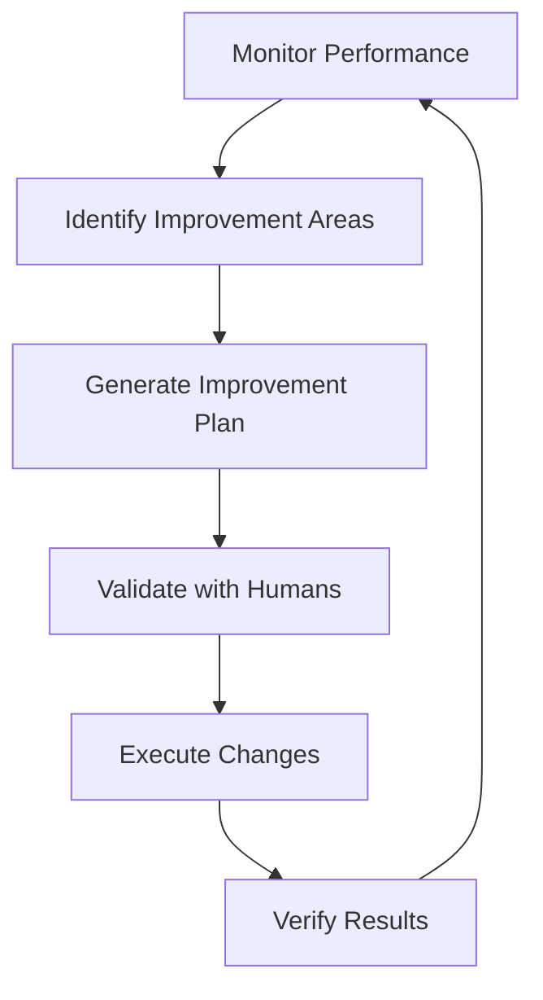
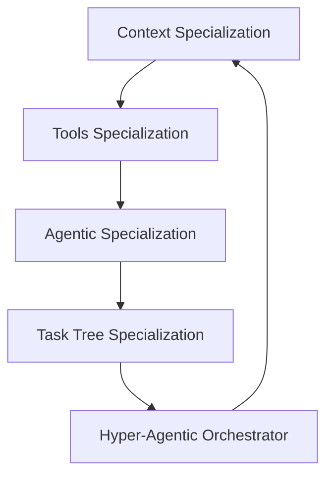

# High-Level Design: Framework for Self-Awareness and Self-Improvement

## Ptrompt that generated this file and the roadmap:
ok we are at a stable situation where the unit tests of test_create_tools_dynamically are passing.
but now I am thinking if it is the right time to test the ui and it looks that I am not totaly convinced that the task is running the crewai configuration and that the tools are really been called (as that was the previous situation, moving back to fix it with unit tests took me two full working days).

I think we should analyse the current situation and derive a stratgy to continue with the development.
the goal is to be able to achieve self awareness, a stage where the framework will be able to improve itself.
the dynamic tools generation is a step forward and my reasoning is that if we can achieve the tree specialization of, generating tools, agentics and taks trees (thier is still one more that we need and it is the context specialization) we will be able to construct a hyper agentic mechanism that iterates the tasks context tools and agentic to perform a goal that requires self imprtovments, we will be thinking later on the human in the loop, as the framewokr will be able to consult with, humans that will be available to the system and that humaens will be able to add their inpunt though the process.

make sure that my vision is complete seet that will support the goal.
Provide an in depth documentation hld and roadmap reflectig this

# High-Level Design documet by Claude-3.5-sonnet

## Overview
This document outlines the high-level design for transforming the current framework into a self-aware system capable of self-improvement. The design focuses on creating a hyper-agentic mechanism that can orchestrate its own evolution through specialized components working in harmony.

## Current State Analysis

### Strengths
1. **Tools Catalog Infrastructure**
   - Robust singleton pattern implementation
   - Clear separation between internal and external tools
   - Support for multiple tool types (Python, CrewAI, LangChain, OpenAPI)

2. **Dynamic Tools Generation**
   - Basic infrastructure for dynamic tool creation
   - Integration with LangChain tools ecosystem
   - Test coverage for core functionality

3. **Task Tree System**
   - Hierarchical task execution
   - Support for parallel and sequential execution
   - Context propagation between tasks

### Gaps
1. **Tool Execution Verification**
   - Limited visibility into actual tool execution
   - Need for better monitoring and validation
   - Lack of execution metrics and feedback

2. **Context Management**
   - Context specialization not fully implemented
   - Limited context persistence and evolution
   - Need for better context sharing between specializations

3. **Human Interaction Layer**
   - Basic UI without deep integration
   - Limited feedback mechanisms
   - No structured human-in-the-loop process

## Architecture Components

### 1. Specialization Core
The foundation of self-awareness built on four key specializations:

a) **Tools Specialization**
   - Dynamic tool generation and validation
   - Tool performance monitoring
   - Tool evolution and optimization
   - Tool dependency management

b) **Agentic Specialization**
   - Agent role definition and evolution
   - Inter-agent communication protocols
   - Agent capability discovery
   - Agent learning and adaptation

c) **Task Tree Specialization**
   - Dynamic task tree generation
   - Task optimization and restructuring
   - Execution strategy adaptation
   - Performance monitoring and feedback

d) **Context Specialization**
   - Context discovery and categorization
   - Context relationship mapping
   - Context evolution tracking
   - Context validation and refinement

### 2. Hyper-Agentic Orchestrator
Central component managing the interaction between specializations:

- **Meta-Task Management**
  - Cross-specialization task coordination
  - Resource allocation and optimization
  - Goal decomposition and tracking
  - Execution strategy selection

- **Feedback Loop System**
  - Performance metrics collection
  - Improvement opportunity identification
  - Strategy adaptation
  - Learning persistence

### 3. Human Integration Layer
Framework for human-AI collaboration:

- **Interaction Interfaces**
  - Web-based UI for monitoring and control
  - CLI for direct system interaction
  - API for programmatic access
  - Event notification system

- **Feedback Mechanisms**
  - Real-time consultation requests
  - Decision validation workflows
  - Knowledge capture system
  - Performance review tools

## System Workflows

### 1. Self-Improvement Cycle

### 2. Specialization Interaction

## Key Design Principles

1. **Modularity**
   - Each specialization should be independently evolvable
   - Clear interfaces between components
   - Pluggable architecture for future extensions

2. **Observability**
   - Comprehensive logging and monitoring
   - Performance metrics at all levels
   - Clear execution tracking

3. **Safety**
   - Human oversight integration points
   - Rollback capabilities
   - Gradual capability expansion

4. **Adaptability**
   - Dynamic configuration management
   - Runtime behavior modification
   - Learning from execution history

## Technical Considerations

1. **State Management**
   - Persistent state storage
   - State versioning and rollback
   - State synchronization between components

2. **Performance**
   - Asynchronous execution where possible
   - Resource usage optimization
   - Caching strategies

3. **Security**
   - Access control and authentication
   - Secure communication between components
   - Data encryption and protection

4. **Scalability**
   - Horizontal scaling of components
   - Load balancing considerations
   - Resource allocation strategies

## Integration Points

1. **External Systems**
   - API integration capabilities
   - Event streaming support
   - Data import/export mechanisms

2. **Development Tools**
   - CI/CD pipeline integration
   - Testing frameworks
   - Monitoring and alerting

3. **Human Interfaces**
   - Web UI
   - CLI tools
   - API clients
   - Documentation system
