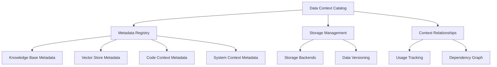
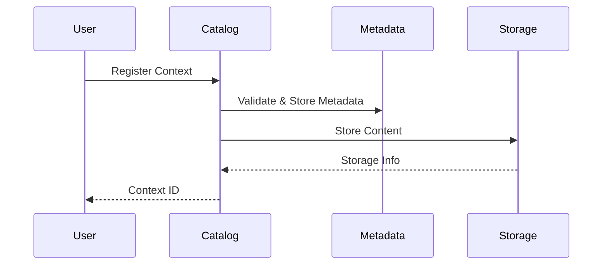
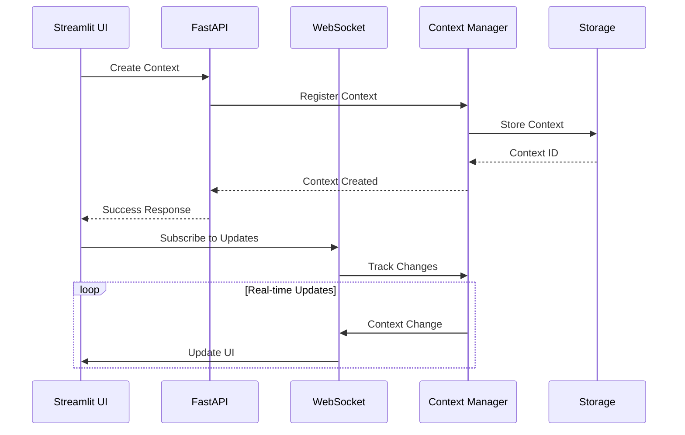
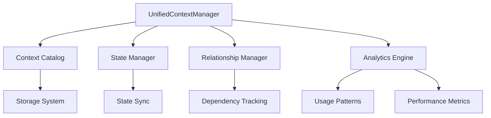

# High-Level Design: Data Context Catalog System

## System Overview

The Data Context Catalog System provides a comprehensive solution for managing, tracking, and utilizing different types of data contexts within Cerebrum. It serves as a central registry for all data bundles, their relationships, and their usage across different subsystems.



## Core Components

### 1. Context Catalog Registry
```python
class ContextCatalogRegistry:
    """Central registry for all context data bundles."""
    
    def __init__(self):
        self.entries: Dict[str, ContextEntry] = {}
        self.relationships: Dict[str, List[str]] = {}
        self.usage_tracking: Dict[str, UsageStats] = {}
        
    async def register_context(
        self,
        content: Union[str, Dict[str, Any]],
        metadata: ContextMetadata,
        storage_backend: str
    ) -> str:
        """Register new context entry."""
        pass
        
    async def get_context_info(
        self,
        context_id: str,
        include_relationships: bool = False
    ) -> ContextInfo:
        """Get comprehensive information about a context entry."""
        pass
```

### 2. Context Metadata System
```python
class ContextMetadata:
    """Rich metadata for context entries."""
    
    source_type: str  # knowledge_base, vector_store, code, system
    data_type: str    # text, code, documentation, etc.
    domain: str       # domain or category
    purpose: str      # intended use
    created_at: datetime
    updated_at: datetime
    version: str
    tags: List[str]
    storage_info: StorageInfo
    validation_rules: Optional[Dict[str, Any]]
    access_control: AccessControl
```

### 3. Storage Management
```python
class ContextStorageManager:
    """Manages different storage backends for context data."""
    
    async def store_context(
        self,
        context_id: str,
        data: Any,
        backend: str,
        config: StorageConfig
    ) -> StorageInfo:
        """Store context data in specified backend."""
        pass
        
    async def retrieve_context(
        self,
        context_id: str,
        storage_info: StorageInfo
    ) -> Any:
        """Retrieve context data from storage."""
        pass
```

## Data Models

### 1. Context Entry Structure
```python
class ContextEntry:
    """Complete context entry information."""
    
    id: str
    metadata: ContextMetadata
    storage_info: StorageInfo
    relationships: ContextRelationships
    validation_status: ValidationStatus
    usage_stats: UsageStats
    access_history: List[AccessRecord]
```

### 2. Context Relationships
```python
class ContextRelationships:
    """Tracks relationships between context entries."""
    
    dependencies: List[str]    # IDs of contexts this entry depends on
    dependents: List[str]      # IDs of contexts that depend on this
    related: List[str]         # IDs of related contexts
    derived_from: Optional[str] # ID of parent context if derived
    versions: List[str]        # IDs of other versions
```

## Functionality

### 1. Context Registration


### 2. Context Discovery
```python
class ContextDiscovery:
    """Enables finding and exploring context entries."""
    
    async def search_contexts(
        self,
        query: str,
        filters: Dict[str, Any],
        include_metadata: bool = True
    ) -> List[ContextEntry]:
        """Search for context entries."""
        pass
        
    async def get_related_contexts(
        self,
        context_id: str,
        relationship_type: str = "all"
    ) -> List[ContextEntry]:
        """Get related context entries."""
        pass
```

### 3. Usage Tracking
```python
class ContextUsageTracker:
    """Tracks how contexts are used in the system."""
    
    async def record_usage(
        self,
        context_id: str,
        usage_type: str,
        user_id: str,
        metadata: Dict[str, Any]
    ) -> None:
        """Record usage of a context."""
        pass
        
    async def get_usage_stats(
        self,
        context_id: str,
        time_range: Optional[TimeRange] = None
    ) -> UsageStats:
        """Get usage statistics for a context."""
        pass
```

## Integration Patterns

### 1. Knowledge Base Integration
```python
class KnowledgeBaseIntegration:
    """Integration with knowledge base system."""
    
    async def register_knowledge(
        self,
        content: str,
        metadata: Dict[str, Any]
    ) -> str:
        """Register knowledge base content."""
        pass
```

### 2. Vector Store Integration
```python
class VectorStoreIntegration:
    """Integration with vector store system."""
    
    async def register_vectors(
        self,
        vectors: List[Vector],
        metadata: Dict[str, Any]
    ) -> str:
        """Register vector data."""
        pass
```

## Management Interface

### 1. Context Management API
```python
class ContextManagementAPI:
    """API for managing context entries."""
    
    async def create_context(self, request: CreateContextRequest) -> str:
        """Create new context entry."""
        pass
        
    async def update_context(
        self,
        context_id: str,
        updates: UpdateContextRequest
    ) -> bool:
        """Update existing context."""
        pass
        
    async def delete_context(self, context_id: str) -> bool:
        """Delete context entry."""
        pass
```

### 2. Monitoring & Analytics
```python
class ContextAnalytics:
    """Analytics for context system."""
    
    async def get_system_stats(self) -> SystemStats:
        """Get system-wide statistics."""
        pass
        
    async def analyze_usage_patterns(
        self,
        time_range: TimeRange
    ) -> UsagePatterns:
        """Analyze context usage patterns."""
        pass
```

## UI and API Integration

### Streamlit UI Integration

1. **Context Dashboard Components**
```python
class ContextDashboard:
    """Main dashboard for context management."""
    
    def __init__(self, context_manager: EnhancedUnifiedContextManager):
        self.context_manager = context_manager
        self.state = st.session_state
        
    def render_dashboard(self):
        """Render main dashboard components."""
        st.title("Context Management System")
        
        # Sidebar navigation
        self.render_sidebar()
        
        # Main content area
        selected_view = self.state.get("selected_view", "overview")
        if selected_view == "overview":
            self.render_overview()
        elif selected_view == "context_browser":
            self.render_context_browser()
        elif selected_view == "relationships":
            self.render_relationship_view()
        elif selected_view == "analytics":
            self.render_analytics()
    
    def render_context_browser(self):
        """Render context browsing and management interface."""
        st.header("Context Browser")
        
        # Search and filters
        search_query = st.text_input("Search Contexts")
        col1, col2 = st.columns(2)
        with col1:
            selected_type = st.selectbox(
                "Context Type",
                ["All", "Knowledge", "Vector", "Code", "System"]
            )
        with col2:
            selected_domain = st.selectbox(
                "Domain",
                ["All", "Development", "Documentation", "Testing"]
            )
        
        # Context list with pagination
        contexts = self._get_filtered_contexts(
            search_query, selected_type, selected_domain
        )
        self._render_context_list(contexts)
```

2. **Context Visualization Components**
```python
class ContextVisualizers:
    """Components for visualizing context data."""
    
    @staticmethod
    def render_relationship_graph(
        context_id: str,
        relationship_data: Dict[str, Any]
    ):
        """Render interactive relationship graph."""
        st.plotly_chart(
            create_relationship_graph(relationship_data),
            use_container_width=True
        )
    
    @staticmethod
    def render_context_timeline(
        context_id: str,
        history: List[Dict[str, Any]]
    ):
        """Render context history timeline."""
        st.altair_chart(
            create_timeline_chart(history),
            use_container_width=True
        )
```

3. **State Management**
```python
class StreamlitStateManager:
    """Manages Streamlit session state for context system."""
    
    def __init__(self):
        if "context_state" not in st.session_state:
            st.session_state.context_state = {
                "selected_contexts": [],
                "view_history": [],
                "filters": {},
                "pagination": {"page": 1, "per_page": 20}
            }
    
    def update_state(self, key: str, value: Any):
        """Update specific state value."""
        st.session_state.context_state[key] = value
    
    def get_state(self, key: str) -> Any:
        """Get state value."""
        return st.session_state.context_state.get(key)
```

### FastAPI Integration

1. **API Router Structure**
```python
class ContextAPIRouter:
    """FastAPI router for context management endpoints."""
    
    def __init__(self, context_manager: EnhancedUnifiedContextManager):
        self.router = APIRouter(prefix="/api/v1/context")
        self.context_manager = context_manager
        self._setup_routes()
    
    def _setup_routes(self):
        @self.router.post("/")
        async def create_context(
            request: CreateContextRequest,
            current_user: User = Depends(get_current_user)
        ) -> ContextResponse:
            """Create new context entry."""
            context_id = await self.context_manager.register_context(
                content=request.content,
                source_type=request.source_type,
                metadata=request.metadata
            )
            return ContextResponse(id=context_id)
        
        @self.router.get("/{context_id}/relationships")
        async def get_relationships(
            context_id: str,
            depth: int = Query(1, ge=1, le=3),
            current_user: User = Depends(get_current_user)
        ) -> RelationshipResponse:
            """Get context relationships."""
            relationships = await self.context_manager.get_relationships(
                context_id=context_id,
                depth=depth
            )
            return RelationshipResponse(relationships=relationships)
```

2. **WebSocket Integration**
```python
class ContextWebSocket:
    """WebSocket handler for real-time context updates."""
    
    def __init__(self, context_manager: EnhancedUnifiedContextManager):
        self.context_manager = context_manager
        self.active_connections: Dict[str, List[WebSocket]] = {}
    
    async def connect(
        self,
        websocket: WebSocket,
        context_id: str,
        current_user: User = Depends(get_current_user)
    ):
        """Handle new WebSocket connection."""
        await websocket.accept()
        if context_id not in self.active_connections:
            self.active_connections[context_id] = []
        self.active_connections[context_id].append(websocket)
        
        try:
            async for update in self.context_manager.track_state_changes(
                context_id
            ):
                await websocket.send_json(update.dict())
        except WebSocketDisconnect:
            self.active_connections[context_id].remove(websocket)
```

3. **API Models**
```python
class APIModels:
    """Pydantic models for API requests and responses."""
    
    class CreateContextRequest(BaseModel):
        """Request model for context creation."""
        content: Union[str, Dict[str, Any]]
        source_type: str
        metadata: ContextMetadata
        
        class Config:
            schema_extra = {
                "example": {
                    "content": "Example content",
                    "source_type": "knowledge",
                    "metadata": {
                        "domain": "development",
                        "tags": ["documentation", "example"]
                    }
                }
            }
    
    class ContextResponse(BaseModel):
        """Response model for context operations."""
        id: str
        status: str = "success"
        metadata: Optional[Dict[str, Any]]
```

### Integration Architecture



### Implementation Considerations

1. **UI Performance**
   - Implement virtual scrolling for large context lists
   - Use caching for frequently accessed contexts
   - Optimize relationship graph rendering
   - Implement progressive loading

2. **API Scalability**
   - Use connection pooling
   - Implement rate limiting
   - Cache API responses
   - Use async operations

3. **Real-time Updates**
   - Handle WebSocket reconnection
   - Implement message queuing
   - Manage connection state
   - Handle concurrent updates

4. **Security**
   - Implement JWT authentication
   - Add role-based access control
   - Validate all inputs
   - Sanitize outputs

### Development Workflow

1. **Phase 1: Core UI**
   - Implement basic dashboard
   - Create context browser
   - Add search and filters
   - Set up basic visualizations

2. **Phase 2: API Development**
   - Create REST endpoints
   - Implement WebSocket support
   - Add authentication
   - Set up documentation

3. **Phase 3: Integration**
   - Connect UI to API
   - Implement real-time updates
   - Add error handling
   - Create loading states

4. **Phase 4: Enhancement**
   - Add advanced visualizations
   - Implement batch operations
   - Add export/import
   - Create admin interface

### Success Metrics

1. **UI Performance**
   - Initial load < 2s
   - Context list rendering < 500ms
   - Graph rendering < 1s
   - Search response < 200ms

2. **API Performance**
   - Endpoint response < 100ms
   - WebSocket latency < 50ms
   - Concurrent connections > 1000
   - Zero dropped messages

3. **User Experience**
   - < 3 clicks for common operations
   - Clear error messages
   - Intuitive navigation
   - Responsive design

## Implementation Phases

### Phase 1: Core Infrastructure
1. Implement base catalog registry
2. Create metadata system
3. Set up storage management

### Phase 2: Integration
1. Integrate with knowledge base
2. Integrate with vector store
3. Implement code context handling

### Phase 3: Enhancement
1. Add relationship tracking
2. Implement usage analytics
3. Create management interface

### Phase 4: Advanced Features
1. Add versioning support
2. Implement access control
3. Add validation system

## Success Metrics

1. **System Performance**
   - Context registration < 100ms
   - Context retrieval < 50ms
   - Search response < 200ms

2. **Data Quality**
   - 100% metadata completeness
   - < 1% orphaned contexts
   - < 0.1% invalid relationships

3. **System Reliability**
   - 99.9% uptime
   - < 0.1% error rate
   - 100% data consistency

## Security Considerations

1. **Access Control**
   - Role-based access
   - Context-level permissions
   - Audit logging

2. **Data Protection**
   - Encryption at rest
   - Secure transmission
   - Data validation

## Monitoring & Maintenance

1. **System Health**
   - Storage utilization
   - Response times
   - Error rates

2. **Data Health**
   - Metadata completeness
   - Relationship integrity
   - Usage patterns

## Future Enhancements

1. **Advanced Features**
   - Real-time updates
   - Advanced search
   - Automated tagging

2. **Integration Expansion**
   - External system integration
   - API gateway
   - Custom plugins

## UnifiedContextManager Integration

### Current Implementation Analysis

The existing UnifiedContextManager provides several key capabilities:

1. **Data Source Management**
```python
class DataSource:
    """Data source types for context preparation."""
    WEB = "web"
    REPOSITORY = "repository"
    FILE = "file"
    API = "api"
    CUSTOM = "custom"
```

2. **Prepared Data Handling**
```python
class PreparedData:
    """Container for prepared data that can be reused across states."""
    content: Union[str, Dict[str, Any]]
    source_type: str
    metadata: Dict[str, Any]
    data_hash: str
    created_at: str
```

3. **Context Operations**
- Knowledge base integration
- Vector store management
- Task context handling
- System context support
- Documentation management

### Enhancement Opportunities

1. **Context Catalog Integration**
```python
class EnhancedUnifiedContextManager:
    """Enhanced manager with catalog integration."""
    
    def __init__(self):
        self.context_catalog = ContextCatalogRegistry()
        self.unified_manager = UnifiedContextManager()
        
    async def register_context(
        self,
        content: Union[str, Dict[str, Any]],
        source_type: str,
        metadata: ContextMetadata
    ) -> str:
        """Register context in both systems."""
        # Prepare data using existing manager
        prepared_data = await self.unified_manager.prepare_data(
            source_type=source_type,
            source=content,
            metadata=metadata.dict()
        )
        
        # Register in catalog
        context_id = await self.context_catalog.register_context(
            content=prepared_data.content,
            metadata=metadata,
            storage_backend=self._get_storage_backend(source_type)
        )
        
        return context_id
```

2. **Enhanced State Management**
```python
class ContextStateManager:
    """Manages context state across systems."""
    
    async def sync_states(
        self,
        context_id: str,
        target_systems: List[str]
    ) -> Dict[str, bool]:
        """Synchronize context state across systems."""
        pass
        
    async def track_state_changes(
        self,
        context_id: str
    ) -> AsyncGenerator[StateChange, None]:
        """Track and broadcast state changes."""
        pass
```

3. **Relationship Enhancement**
```python
class ContextRelationshipManager:
    """Enhanced relationship management."""
    
    async def track_dependencies(
        self,
        context_id: str,
        operation_type: str
    ) -> List[str]:
        """Track context dependencies during operations."""
        pass
        
    async def analyze_relationships(
        self,
        context_id: str
    ) -> RelationshipGraph:
        """Analyze and visualize context relationships."""
        pass
```

4. **Usage Analytics Integration**
```python
class ContextAnalyticsManager:
    """Enhanced analytics capabilities."""
    
    async def track_operation(
        self,
        context_id: str,
        operation: str,
        metadata: Dict[str, Any]
    ) -> None:
        """Track context operations with rich metadata."""
        pass
        
    async def generate_insights(
        self,
        context_id: str
    ) -> ContextInsights:
        """Generate insights from context usage patterns."""
        pass
```

### Integration Architecture



### Implementation Strategy

1. **Phase 1: Core Integration**
   - Implement EnhancedUnifiedContextManager
   - Set up context catalog integration
   - Create basic state synchronization

2. **Phase 2: Relationship Enhancement**
   - Implement relationship tracking
   - Add dependency analysis
   - Create visualization tools

3. **Phase 3: Analytics Integration**
   - Set up usage tracking
   - Implement analytics pipeline
   - Create reporting system

4. **Phase 4: Advanced Features**
   - Add real-time synchronization
   - Implement advanced search
   - Create recommendation system

### Success Metrics

1. **Integration Performance**
   - Context synchronization < 200ms
   - State updates < 100ms
   - Relationship tracking < 150ms

2. **Data Consistency**
   - 100% state consistency
   - < 0.1% sync failures
   - Zero orphaned relationships

3. **System Efficiency**
   - < 10% overhead from integration
   - < 5% additional storage usage
   - < 1% performance impact

### Technical Considerations

1. **State Management**
   - Use optimistic locking for updates
   - Implement retry mechanisms
   - Handle partial failures

2. **Performance Optimization**
   - Cache frequently used contexts
   - Batch relationship updates
   - Use incremental sync

3. **Error Handling**
   - Implement circuit breakers
   - Add fallback mechanisms
   - Create recovery procedures

### Future Roadmap

1. **Advanced Integration**
   - Real-time collaboration support
   - Multi-user context sharing
   - Advanced permission management

2. **Enhanced Analytics**
   - Machine learning insights
   - Pattern recognition
   - Automated optimization

3. **Extended Features**
   - Context versioning
   - Branching and merging
   - Automated documentation 