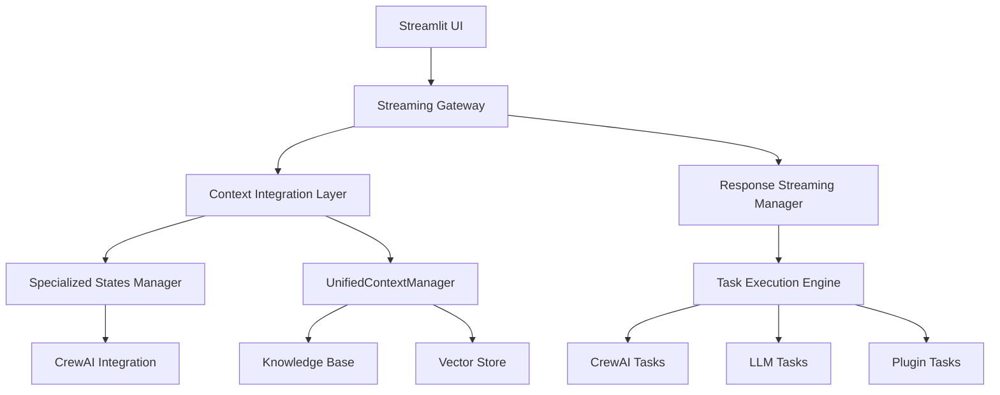
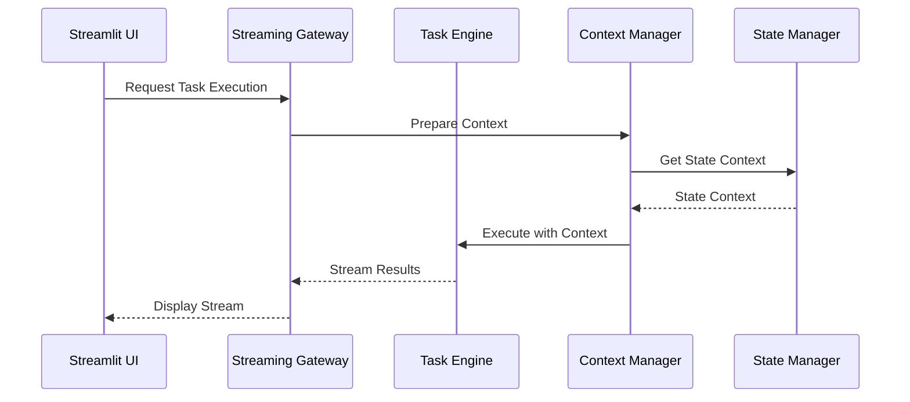
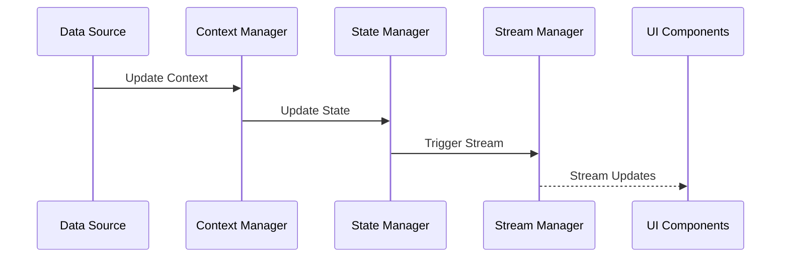

# High-Level Design: Streaming Context Integration System

## System Overview

The Streaming Context Integration System is designed to provide real-time, streaming capabilities for Cerebrum's specialized states system while maintaining seamless integration between CrewAI, Streamlit UI, and the context management system.



## Core Components

### 1. Streaming Gateway
- **Purpose**: Manages all streaming connections and data flow
- **Key Features**:
  - WebSocket management
  - Connection pooling
  - Stream multiplexing
  - Error handling
- **Integration Points**:
  - Streamlit UI
  - API endpoints
  - Task execution system

### 2. Context Integration Layer
```python
class ContextIntegrationLayer:
    """Manages context flow between components."""
    
    async def integrate_context(
        self,
        source: str,
        context: Dict[str, Any],
        target: str
    ) -> bool:
        """Integrate context between different system components."""
        pass

    async def stream_context_updates(
        self,
        context_id: str
    ) -> AsyncGenerator[Dict[str, Any], None]:
        """Stream context updates to subscribers."""
        pass
```

### 3. Specialized States System
```python
class SpecializedState:
    """Enhanced specialized state with streaming support."""
    
    def __init__(self):
        self.context_manager = ContextManager()
        self.stream_manager = StreamManager()
        self.state_data = StateData()

    async def process_stream(
        self,
        stream_type: str,
        data: AsyncGenerator
    ) -> AsyncGenerator:
        """Process incoming stream data."""
        pass
```

### 4. Response Streaming System
```python
class ResponseStreamManager:
    """Manages response streaming for different sources."""
    
    async def create_stream(
        self,
        source_type: str,
        config: Dict[str, Any]
    ) -> StreamController:
        """Create new response stream."""
        pass

    async def process_stream(
        self,
        stream: StreamController,
        processor: Callable
    ) -> AsyncGenerator:
        """Process stream with custom processor."""
        pass
```

## Data Flow

### 1. Task Execution Flow


### 2. Context Update Flow


## State Management

### 1. State Hierarchy
```
SpecializedState
├── BaseContext
│   ├── UIContext
│   ├── APIContext
│   └── TaskContext
├── StreamingState
│   ├── ActiveStreams
│   └── StreamMetadata
└── ExecutionState
    ├── TaskStatus
    └── Results
```

### 2. Context Types
```python
class ContextTypes:
    """Available context types in the system."""
    
    KNOWLEDGE = "knowledge"
    VECTOR = "vector"
    SYSTEM = "system"
    UI = "ui"
    API = "api"
    TASK = "task"
    STREAM = "stream"
```

## Integration Patterns

### 1. CrewAI Integration
```python
class CrewAIStreamAdapter:
    """Adapts CrewAI responses for streaming."""
    
    async def adapt_response(
        self,
        crew_response: AsyncGenerator
    ) -> AsyncGenerator[Dict[str, Any], None]:
        """Convert CrewAI response to stream format."""
        pass
```

### 2. Streamlit Integration
```python
class StreamlitStreamManager:
    """Manages Streamlit streaming components."""
    
    def create_stream_component(
        self,
        stream_type: str
    ) -> StreamlitComponent:
        """Create streaming-aware Streamlit component."""
        pass
```

## Security Considerations

1. **Authentication & Authorization**
   - Token-based stream authentication
   - Role-based access control
   - Stream permission management

2. **Data Protection**
   - End-to-end encryption for sensitive streams
   - Secure context storage
   - Access logging and monitoring

## Performance Optimization

1. **Stream Management**
   - Connection pooling
   - Backpressure handling
   - Memory management
   - Cache optimization

2. **Context Optimization**
   - Context caching
   - Lazy loading
   - Incremental updates
   - Compression

## Monitoring & Observability

1. **Metrics Collection**
   ```python
   class StreamMetrics:
       """Collects streaming metrics."""
       
       async def collect_metrics(
           self,
           stream_id: str
       ) -> Dict[str, Any]:
           """Collect stream performance metrics."""
           pass
   ```

2. **Health Checks**
   ```python
   class StreamHealthCheck:
       """Monitors stream health."""
       
       async def check_health(
           self,
           stream_id: str
       ) -> HealthStatus:
           """Check stream health status."""
           pass
   ```

## Error Handling

1. **Stream Error Recovery**
   ```python
   class StreamErrorHandler:
       """Handles streaming errors."""
       
       async def handle_error(
           self,
           error: Exception,
           stream: StreamController
       ) -> bool:
           """Handle stream error and attempt recovery."""
           pass
   ```

2. **Fallback Mechanisms**
   - Automatic reconnection
   - State recovery
   - Error reporting

## Implementation Phases

### Phase 1: Core Infrastructure
1. Implement base streaming system
2. Set up context integration
3. Create state management

### Phase 2: Integration
1. Integrate with CrewAI
2. Implement Streamlit components
3. Set up API endpoints

### Phase 3: Enhancement
1. Add monitoring
2. Implement security
3. Optimize performance

### Phase 4: Testing & Documentation
1. Create test suite
2. Write documentation
3. Create examples

## Success Metrics

1. **Performance**
   - Response time < 100ms
   - Memory usage < 500MB
   - CPU usage < 50%

2. **Reliability**
   - 99.9% uptime
   - < 0.1% error rate
   - < 1s recovery time

3. **Scalability**
   - Support 1000+ concurrent streams
   - Handle 10GB+ context data
   - Process 1000+ tasks/hour 